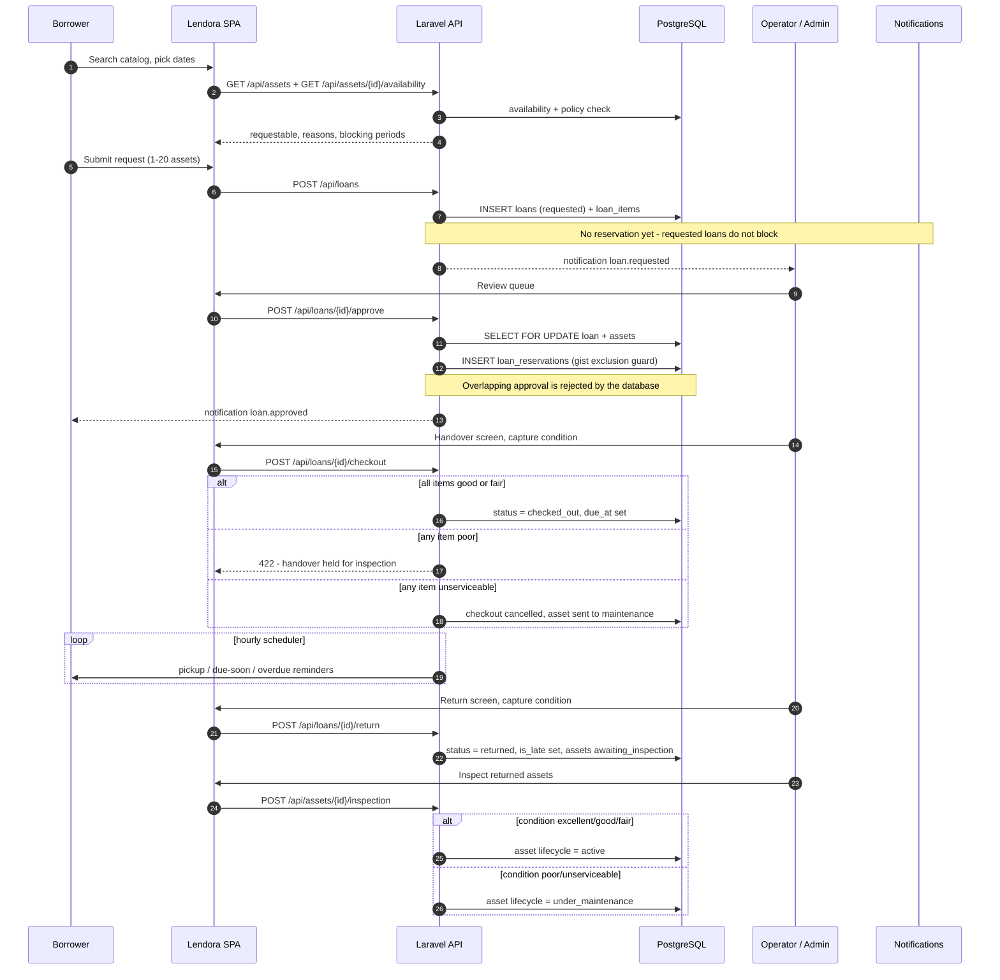
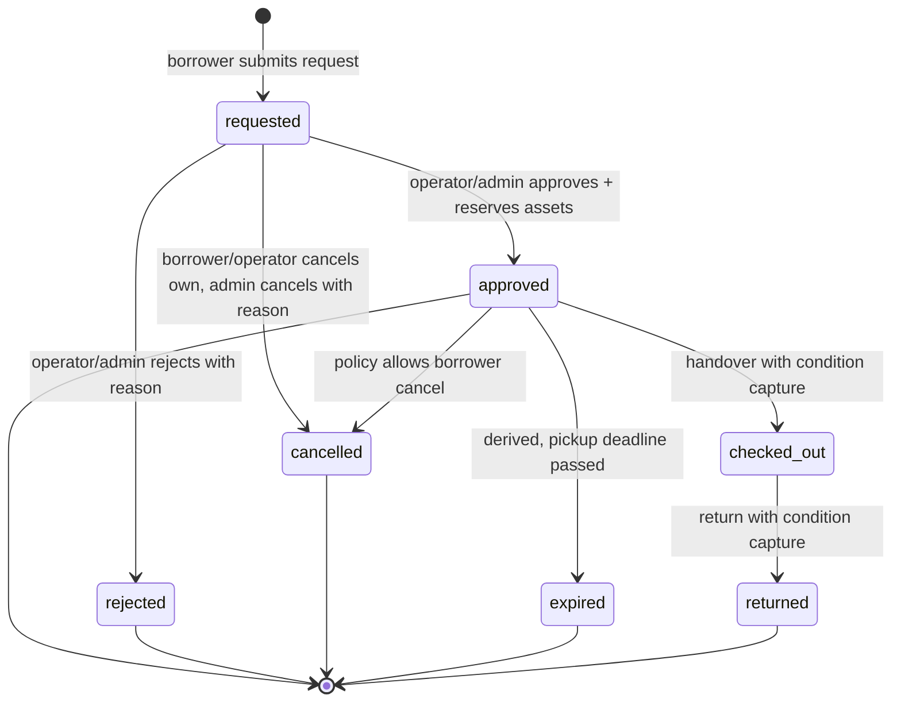
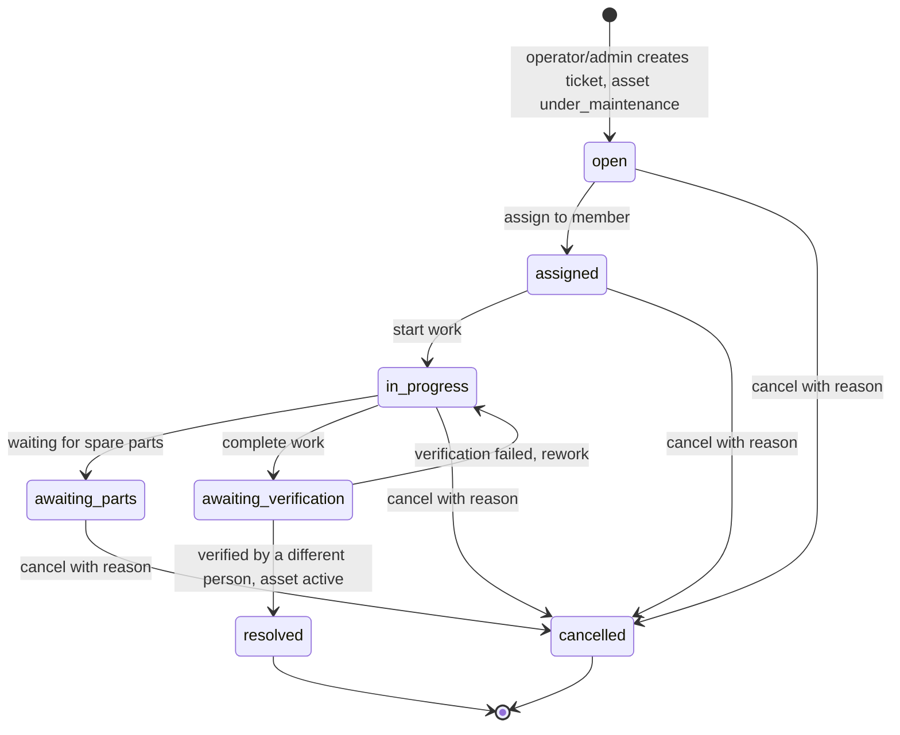
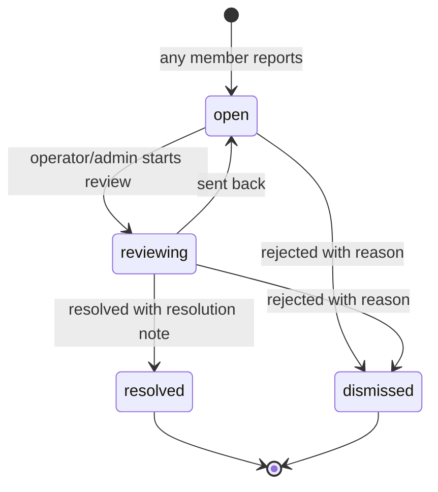
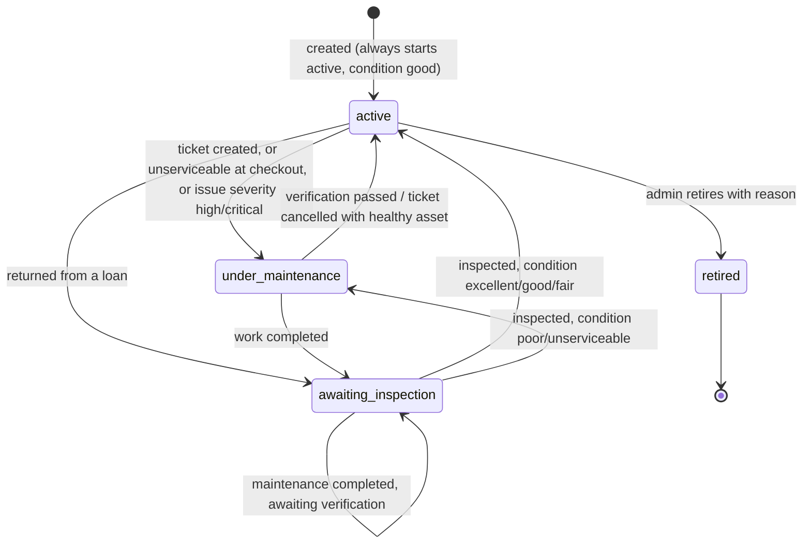
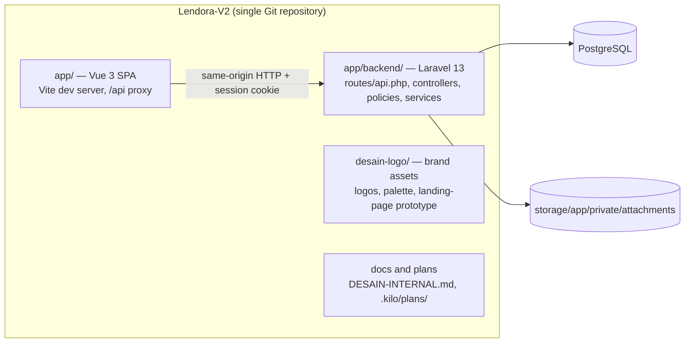
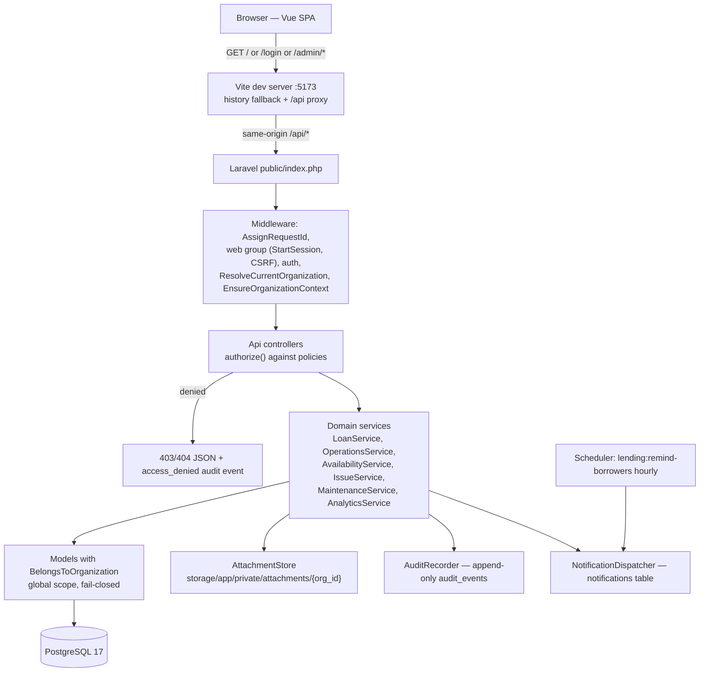
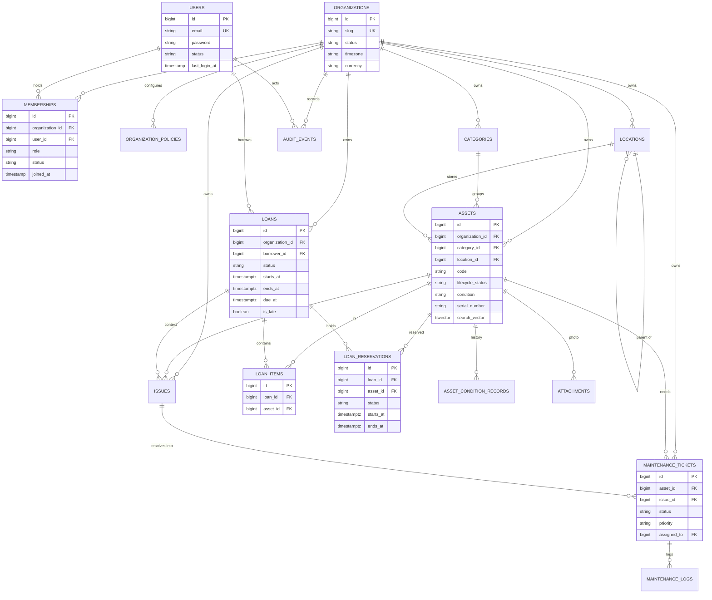

<p align="center">
  <picture>
    <source media="(prefers-color-scheme: dark)" srcset="../desain-logo/logo/lendora-lockup-inverse.svg">
    
  </picture>
</p>

<h1 align="center">Lendora V2</h1>

<p align="center">
  <strong>Multi-tenant asset management and controlled lending for organizations.</strong><br>
  <em>A catalog of physical assets, a reservation-safe borrowing lifecycle, handover inspections,
  maintenance tracking, and an append-only audit trail — built for organizations that lend their own equipment to their own people.</em>
</p>

<p align="center">
  
  
  
  
  
  
  
</p>

<p align="center">
  <a href="#project-overview">Overview</a> ·
  <a href="#core-features">Features</a> ·
  <a href="#user-roles-and-permissions">Roles</a> ·
  <a href="#business-workflow">Workflow</a> ·
  <a href="#technology-stack">Stack</a> ·
  <a href="#system-architecture">Architecture</a> ·
  <a href="#database-design">Database</a> ·
  <a href="#installation-and-setup">Setup</a> ·
  <a href="#api-documentation">API</a> ·
  <a href="#testing-and-quality-assurance">Testing</a> ·
  <a href="#limitations-and-project-status">Status</a>
</p>

---

## Table of Contents

- [Project Overview](#project-overview)
- [Core Features](#core-features)
- [User Roles and Permissions](#user-roles-and-permissions)
- [Business Workflow](#business-workflow)
- [Screenshots and Visual Showcase](#screenshots-and-visual-showcase)
- [Technology Stack](#technology-stack)
- [System Architecture](#system-architecture)
- [Database Design](#database-design)
- [Project Structure](#project-structure)
- [Requirements and Prerequisites](#requirements-and-prerequisites)
- [Installation and Setup](#installation-and-setup)
- [Environment Configuration](#environment-configuration)
- [API Documentation](#api-documentation)
- [Security and Access Control](#security-and-access-control)
- [Testing and Quality Assurance](#testing-and-quality-assurance)
- [Limitations and Project Status](#limitations-and-project-status)
- [Roadmap](#roadmap)
- [Contributing](#contributing)
- [License and Credits](#license-and-credits)
- [Acknowledgements and Contact](#acknowledgements-and-contact)
- [Documentation Notes](#documentation-notes)

---

## Project Overview

### What Lendora is

Lendora is a **web application for managing an organization's own physical assets and the lending of those assets to its own members**. It is not a generic "loan anything" marketplace: every asset, category, location, member, ticket, and policy record belongs to exactly one organization (tenant), and access to that data is scoped by a membership row that also carries the user's role.

The system covers the full operational loop that a studio, laboratory, library, or office runs when it hands cameras, laptops, projectors, or measurement gear to its staff:

| Concern | How Lendora handles it |
| --- | --- |
| What do we own? | Asset catalog with codes, categories, hierarchical locations, condition, serial numbers, purchase data, warranty, and photos |
| Who may borrow it? | Memberships with three roles (`borrower`, `operator`, `admin`) and per-organization lending policy limits |
| Is it free during the requested window? | Availability evaluation + a PostgreSQL exclusion constraint that makes double-booking impossible at the database level |
| Did it leave the building, and in what state? | Checkout with a mandatory per-asset condition capture (notes and photos required for bad condition) |
| When is it back, and is it late? | Due dates, pickup deadlines derived from policy, late flags, and an hourly reminder command |
| Did something break? | Issue reports with severity that automatically locks the asset out of circulation, plus a full maintenance ticket lifecycle with verification |
| Can we prove who did what? | Append-only audit events on every mutation, plus in-app notifications for every loan state change |

### The problem it addresses

Organizations that lend equipment to their own people usually track it in spreadsheets, chat groups, or memory. That approach fails predictably:

- **Double-booking.** Two people are told the same camera is free for the same dates; one is disappointed at pickup time.
- **Silent state drift.** The asset is fine "most of the time"; nobody records that it came back with a cracked mount, so the next borrower inherits the damage.
- **No accountability.** When equipment disappears, there is no record of who had it, who approved it, or when it was last inspected.
- **Policy that lives in someone's head.** Loan duration, notice, quota, and pickup windows are real rules but are usually not enforced by any system.

Lendora encodes those rules in code and in the database, and records the evidence needed to answer "what happened to this asset?" after the fact.

### Goals and scope

**In scope and implemented:**

- Multi-tenant organizations with membership-scoped roles and fail-closed tenant isolation.
- Asset catalog with lifecycle status, condition grading, photos, categories, and hierarchical locations.
- A reservation-safe lending lifecycle: request → approve/reject → checkout → return, with availability and policy enforcement.
- Condition capture at handover and return, and a standalone inspection workflow for returned assets.
- Issue reporting with severity-driven asset lockout, and a maintenance ticket workflow with assignment, parts waiting, completion, and **four-eyes verification** (the technician cannot verify their own work).
- Organization-level policy configuration (loan duration, notice, quota, pickup window, borrower cancellation, and inspection flags).
- In-app notifications, an hourly reminder command, analytics dashboards, and CSV report export.
- A full append-only audit journal with request correlation IDs.

**Deliberately out of scope for V2:** public marketplace lending, payments or deposits, external integrations (email/SMS delivery, SSO, barcode/QR scanning), mobile-native apps, and multi-language UI. See [Limitations and Project Status](#limitations-and-project-status).

### Users and stakeholders

| Actor | Who they are | What they need from the system |
| --- | --- | --- |
| **Borrower** | Staff member who borrows equipment | A trustworthy catalog, a clear request flow, visibility into what they hold and when it is due, and a way to report damage |
| **Operator** | Warehouse/asset steward who physically handles gear | The day's queue: what to hand over, what is due back, what is overdue, what needs inspection |
| **Admin** | Organization owner/manager | Control of the catalog, members, policy, plus organization-wide analytics and exports |
| **Auditor / owner** | Reads reports and the audit trail after the fact | Evidence of who did what, and which assets are actually under-utilized or problematic |

### How the application is used in practice

1. An **admin** registers the organization and its assets (code, category, location, serial, purchase data), and configures the organization policy.
2. A **borrower** searches the catalog, checks availability for their dates, and submits one request that can cover multiple assets.
3. An **operator** approves or rejects the request. Approval writes reservation rows that block those assets for that period — including against concurrent approvals.
4. At pickup, the **operator** opens the handover screen, records each asset's condition, and confirms. Assets found `poor` block the handover; `unserviceable` cancels it and routes the asset to maintenance.
5. During the loan, the scheduler sends pickup, due-soon, and overdue reminders.
6. At return, the **operator** records the return condition. The loan closes, late status is recorded, and every returned asset moves to `awaiting_inspection`.
7. An **operator** inspects each returned asset. Healthy → back to `active`; bad → `under_maintenance`.
8. Any member can report an issue. High/critical severity automatically takes the asset out of circulation and notifies management.
9. An **operator or admin** opens a maintenance ticket, assigns it, works it, completes it, and a **different** person verifies the result — which is what returns the asset to `active`.
10. **Admins** review utilization, problem assets, and loan statistics, and export CSV reports.

### Language of the product

The **user interface and validation messages are written in Indonesian** (hardcoded; there is no i18n layer yet — see [Limitations](#limitations-and-project-status)). This document, the code comments' technical identifiers, and database field names are in English. `APP_LOCALE` is currently `en` in `.env.example` even though user-facing copy is Indonesian.

### Brand and design

The product follows a deliberately austere internal design contract (`app/DESAIN-INTERNAL.md`): monochrome-first, **zero corner radius**, no gradients or drop shadows, content readable without animation, and `prefers-reduced-motion` honored globally. The landing page (which uses the full brand expression, including a WebGL camera object) is intentionally more expressive than the internal application.

---

## Core Features

Every feature below is implemented in the repository and reachable from the UI or the API. Nothing on this list is aspirational.

### Identity, registration, and tenancy

- **Self-registration into an organization** — `POST /api/register` accepts a name, email, password, and an `organization_slug` (validated as optional, but the controller requires it — omitting it yields a bare 404). The new user is created with `status = pending` and an `invited` membership with `role = borrower` and `joined_at = null`. The user cannot log in until an admin activates the membership. Registration is rate-limited per IP (5/minute).
- **Session login with active-account gate** — `POST /api/login` verifies the password hash, then rejects inactive accounts with HTTP 403 ("Akun menunggu aktivasi" / "Akun tidak aktif"), regenerates the session ID, updates `last_login_at`, and stores the resolved `active_organization_id` in the session. Wrong credentials return HTTP 422 with a generic Indonesian message (no user enumeration) and write an `auth.login_failed` audit event. Login is rate-limited per email+IP (5/minute).
- **Multi-organization membership** — a user can hold memberships in several organizations. `/api/me` returns the visible organizations and the active role; `POST /api/organization/switch` changes the active tenant and returns the new role. The admin shell exposes an organization switcher when more than one is available.
- **Tenant resolution middleware** — `ResolveCurrentOrganization` selects the session's organization when the membership is still active, otherwise falls back to the user's first active membership, and always clears the context in a `finally` block. `EnsureOrganizationContext` returns 403 when no active membership exists.
- **Fail-closed global scope** — `BelongsToOrganization` adds an `organization` global scope to every tenant-owned model; when no tenant context is bound the scope compiles to `whereRaw('1 = 0')` rather than leaking all rows. `organization_id` is auto-filled on create.
- **Session revocation** — setting a membership to `inactive` deletes that user's rows from the `sessions` table, terminating their active sessions immediately.

### Asset catalog

- **Asset record** — `code` (unique per organization, immutable after creation), `name`, `description`, `category_id`, `location_id`, `serial_number` (unique per organization when set, immutable), `lifecycle_status`, `condition`, `purchase_date`, `purchase_price` (non-negative), `warranty_until` (must be after the purchase date), `notes`, and up to 10 photos.
- **Full-text search** — the `assets` table carries a generated `tsvector` column (`name` + `description`, `simple` configuration) with a GIN index, queried via `plainto_tsquery`.
- **Lifecycle status** — `active`, `awaiting_inspection`, `under_maintenance`, `retired`. Only `active` assets are borrowable; retired assets are excluded from the catalog for borrowers.
- **Condition grading** — `excellent`, `good`, `fair`, `poor`, `unserviceable`. Condition and lifecycle are deliberately **not** editable through the asset form: they only change through inspection, checkout/check-in, and maintenance outcomes.
- **Categories** — per-organization, unique among live rows, and blocked from deletion while any asset references them.
- **Locations** — a hierarchy up to four levels deep, unique per level within the organization, with move-protection (a location cannot be moved under its own descendant, and moves that would exceed depth four are rejected). Child levels are recomputed after a move. Deletion is blocked when the location has children or assets.
- **Retirement and deletion** — retiring requires a reason (3–2000 characters) and is admin-only; retiring an already-retired asset returns 422. Deletion is a soft delete, admin-only, and removes the asset from the catalog.
- **Role-scoped visibility** — all three roles can browse the catalog; **borrowers never see** `lifecycle_status`, `condition`, `serial_number`, `purchase_date`, `purchase_price`, `warranty_until`, or `notes`. Those fields are stripped at the API resource layer, not hidden in the UI. Borrowers also cannot filter by condition.

### Availability and reservations

- **Availability evaluation** — `AvailabilityService::evaluate()` returns per-asset availability plus human-readable Indonesian reasons covering lifecycle blocking, reservation overlaps, and every applicable policy violation.
- **Policy limits enforced at request time** — maximum loan duration, minimum loan duration, minimum notice before start, maximum advance booking window, maximum concurrent active loans per borrower, and a rule that a borrower cannot re-book an asset they already hold.
- **Half-open interval semantics** — a loan ending exactly when the next begins is not a conflict.
- **Requested loans do not block each other** — the period is reserved only at approval time.
- **Expired approvals release the period** — an approved loan whose pickup deadline has passed stops blocking the asset.
- **Database-level guarantee** — `loan_reservations` carries a PostgreSQL `EXCLUDE USING gist (asset_id WITH =, tstzrange(starts_at, ends_at) WITH &&)` constraint, so two concurrent approvals for the same asset and overlapping period cannot both commit. The application translates the resulting `23P01` exclusion violation into the same user-facing conflict message.
- **Availability preview endpoint** — `GET /api/assets/{id}/availability` returns `requestable`, the list of `reasons`, the asset, and the blocking periods (start, end, status, borrower).

### Lending lifecycle

- **Request** — a borrower submits `starts_at`, `ends_at`, an optional purpose, and 1–20 distinct assets. Availability is re-checked inside the service under a transaction. Reservations are **not** created at request time.
- **Approve / reject** — operator or admin. Approval locks the loan, re-checks availability, sets `approved_by`/`approved_at`, sets `due_at`, and writes one reservation row per asset. Rejection requires a reason (3–2000 characters).
- **Cancel** — the borrower may cancel their own `requested` loan, and their own `approved` loan only when the organization policy sets `allow_borrower_cancel = true`. Operators may cancel their own. **Admins may cancel anyone's loan, but only with a mandatory reason.** Cancellation deletes the reservation rows.
- **Derived states** — `is_expired` (pickup deadline passed), `is_awaiting_pickup`, `is_overdue`, and `days_until_due` are computed at read time from the organization's `pickup_window_hours`; `expired` is never written to the database even though it appears in the status vocabulary.
- **Legal transitions only** — the transition table is a model constant, and both the lending and operations services reject any other move with "Transisi dari {status} ke {target} tidak diizinkan."

### Handover operations (checkout, return, inspection)

- **Checkout requires an approved loan** and a still-open pickup window; an expired loan cannot be handed over ("Jendela pengambilan sudah lewat").
- **Per-asset condition capture** — the handover screen submits a condition for every item in the loan. The submitted item list must match the loan's items exactly ("Daftar aset harus sama persis dengan isi loan").
- **Bad-condition gates** — an asset recorded as `poor` **blocks** the checkout and sends the asset to inspection, even with notes and photos. An asset recorded as `unserviceable` **cancels** the checkout and routes it to maintenance.
- **Atomicity** — checkout runs in a transaction; if any single asset is not ready, nothing is checked out.
- **Return (check-in)** — records each asset's condition, closes the loan, records `returned_at`/`returned_by`, sets `is_late` when the return is past `due_at`, and moves every returned asset to `awaiting_inspection`. Previous condition records are never modified.
- **Standalone inspection** — only assets in `awaiting_inspection` can be inspected. The result is taken from the newest condition record: blocking conditions send the asset to `under_maintenance`, otherwise it returns to `active`.
- **Condition history is append-only** — enforced by database triggers that raise on `UPDATE` and `DELETE` of `asset_condition_records`, `maintenance_logs`, and `audit_events`.
- **Condition evidence rules** — `poor` and `unserviceable` require notes, and the API additionally requires at least one photo; critical-severity issue reports also require at least one photo. Both rules are enforced server-side.

### Issues and maintenance

- **Issue reporting** — any member can report an issue against any asset in the organization (type `damage`/`loss`/`other`, severity `low`/`medium`/`high`/`critical`, description, optional related loan, up to 10 photos). Reporting on a retired asset is rejected.
- **Severity-driven lockout** — severity may only *raise* an asset's lifecycle rank: `medium` → `awaiting_inspection`, `high`/`critical` → `under_maintenance`. A `low` severity report never changes lifecycle, and severity can never downgrade an asset that is already worse off.
- **Issue workflow** — `open → reviewing → resolved` or `dismissed`, with `reviewing → open` allowed. Resolution requires a resolution note; dismissal requires a reason. Only operators and admins may review, resolve, or dismiss. Borrowers see only the issues they reported; management sees all.
- **Maintenance tickets** — created from an asset (optionally linked to one of its issues), one *blocking* ticket per asset ("Aset ini masih punya tiket perbaikan yang belum selesai"). Priority defaults to the linked issue's severity, otherwise `medium`. Creating a ticket moves the asset to `under_maintenance`.
- **Ticket workflow** — `open → assigned → in_progress → awaiting_parts | awaiting_verification → resolved`, with cancellation available from most states and re-work from `awaiting_verification` back to `in_progress`. Every transition writes exactly one `maintenance_logs` row.
- **Four-eyes verification** — completion moves the ticket to `awaiting_verification` and the asset to `awaiting_inspection`. Verification must be performed by someone other than the assignee ("Teknisi yang mengerjakan tidak boleh memverifikasi hasilnya sendiri") and requires a resulting condition. A blocking condition fails verification and returns the asset to maintenance; a healthy condition resolves the ticket, returns the asset to `active`, and can auto-close the linked issue.
- **Operator dashboard** — `GET /api/operator/today` returns four queues: awaiting pickup, due today, overdue, and awaiting inspection, each capped at 20 entries.

### Borrower experience

- **Borrower dashboard** — one aggregated request returns five counts (active, pending, due soon, completed, overdue), the borrower's active loans sorted by nearest deadline, recent requests, currently borrowable assets, and a meta block. Due-soon uses `due_at` (not `ends_at`) and the threshold is 3 days.
- **Loan calendar** — a dependency-free month grid (Monday-first, 42 cells) with event dots for pickup, loan period, and return, tentative styling for not-yet-approved requests, a legend, and a per-day detail list. Rejected and cancelled loans are excluded.
- **Catalog and availability search** — full-text search with category, location, and status filters, paginated 24 per page.
- **My loans / my reports** — status-grouped tabs for borrowers; status and severity filters for management.
- **Self-service cancel** — with the same policy constraint as the API.

### Notifications, reminders, and audit

- **In-app notifications** stored in Laravel's `notifications` table, always scoped to the requesting user. Keys include `loan.request_pending`, `loan.requested`, `loan.approved`, `loan.rejected`, `loan.cancelled`, `loan.checked_out`, `loan.returned`, `loan.return_confirmed`, `loan.pickup_scheduled`, `loan.due_soon`, `loan.overdue`, `issue.reported`, and `admin.announcement`.
- **Recipient targeting** — borrowers are notified about their own loans; management (active `operator` and `admin` members, excluding the actor) is notified about requests, cancellations, returns, and high/critical issues. Announcements reach all active borrower memberships.
- **Reminder command** — `php artisan lending:remind-borrowers` runs hourly via `routes/console.php` and sends pickup reminders (12h before the pickup deadline), due-soon reminders (3 days before `due_at`), and overdue notices, with per-key deduplication so nothing is sent twice.
- **Audit journal** — every state change records an `audit_events` row with actor, subject (polymorphic), before/after JSONB, context, IP, user agent, and the propagated `X-Request-Id`. Access denials are recorded too (`access_denied` with reason `forbidden` or `resource_not_found`). Audit writes are isolated in their own transaction so an audit failure never masks the business result.

### Analytics and reporting

- **Admin overview** — asset counts by lifecycle and condition, "problematic asset" count, loan counts by status, overdue count, open issues, open tickets, and membership counts by role.
- **Utilization report** — ranks assets by borrow count over a period with the last-borrowed timestamp, filtered explicitly by organization.
- **Problem-assets report** — condition, lifecycle, open/total tickets, and open/total issues per asset.
- **Loan report** — totals by status plus overdue counts for a period.
- **CSV export** — streamed `text/csv` for utilization, problems, and loans, capped at 1000 rows.
- **Query-budget tests** — dashboards and reports are covered by tests that assert a maximum number of database round-trips per request, guarding against N+1 regressions.

### Organization policy

- **Per-organization settings** with `organization_id` as the primary key and full column-level bounds checked in the database (loan duration 1–90 days, minimum duration 1–72 hours, advance window 1–365 days, notice 0–168 hours, pickup window 1–336 hours, active-loan quota 1–50, maintenance notice 1–90 days).
- **Missing rows fall back to defaults in memory** — `OrganizationPolicy::resolve()` returns an unsaved model of defaults rather than writing a row, so an organization without a policy row still enforces the default limits.
- **Admin-only read/write** through `GET`/`PATCH /api/organizations/{organization}/policy`.

---

## User Roles and Permissions

### Roles that exist in the system

Roles live on the **membership**, not on the user. The `users` table has no `role` column; a user's role is whatever their membership says inside the active organization. The database enforces the vocabulary with a CHECK constraint:

```sql
CHECK (role   IN ('borrower', 'operator', 'admin'))
CHECK (status IN ('active', 'inactive', 'invited'))
```

The same three literals appear in the backend model constants, the frontend role map (`app/src/lib/roles.js`), the navigation map (`app/src/lib/navigation.js`), and the members screen.

A **user account** has its own, separate status vocabulary: `pending` (registered, never activated), `active`, `inactive`. Activation happens when an admin sets an `invited` membership to `active`, which also flips the linked `pending` user to `active`.

### Role reference

| | **Borrower** (`borrower`) | **Operator** (`operator`) | **Admin** (`admin`) |
| --- | --- | --- | --- |
| **Responsibility** | Borrows assets, reports problems, tracks their own loans | Runs the physical side: approvals, handover, inspections, maintenance | Owns the catalog, members, policy, and organization-wide reporting |
| **Default landing route** | `/user` (Borrower dashboard) | `/admin` (Today queue) | `/admin` (Overview) |
| **Browse catalog** | Yes (public fields only) | Yes (full detail) | Yes (full detail) |
| **Filter assets by condition / see retired** | No | Yes | Yes |
| **Create / edit / delete assets** | No | Edit only | Yes |
| **Retire asset** | No | No | Yes |
| **Manage categories and locations** | No | No | Yes |
| **Submit a loan request** | Yes | Yes (policy is not role-restricted) | Yes |
| **Approve / reject / checkout / check in** | No | Yes | Yes |
| **Cancel a loan** | Own loan: `requested` always; `approved` only if policy allows | Own loan | Any loan, but a reason is mandatory when cancelling someone else's |
| **Standalone inspection + condition history** | No | Yes | Yes |
| **Maintenance tickets (all actions)** | No | Yes | Yes |
| **Verify maintenance result** | No | Yes, but **not** their own assigned work | Yes, but **not** their own assigned work |
| **Report an issue** | Yes (any asset in the organization) | Yes | Yes |
| **Review / resolve / dismiss an issue** | No | Yes | Yes |
| **See all issues** | No (own reports only) | Yes | Yes |
| **See member list** | No | Yes | Yes |
| **Change role / status of a member** | No | No | Yes |
| **Send announcements** | No | Yes | Yes |
| **Reports, CSV export** | No | No | Yes |
| **Organization policy** | No | No | Yes |
| **Admin overview** | No | No | Yes |

### Where each rule is enforced

There is **no `role:` middleware** in this codebase. Authorization is enforced in four layers:

1. **Route middleware** — `web` (session + CSRF) + `auth` + tenant resolution (`ResolveCurrentOrganization`, `EnsureOrganizationContext`) on every protected route.
2. **Policies** — nine Laravel policy classes resolved by convention (`App\Models\Asset` → `App\Policies\AssetPolicy`). Every FormRequest deliberately returns `true` from `authorize()`; the policies and controllers do the real work.
3. **Controller guards** — a few endpoints (`/admin/overview`, `/reports/*`, `/operator/today`, `/borrower/*`, `/announcements`) use explicit `abort_unless($context->hasRole(...), 403)` checks instead of policies.
4. **Query shaping** — controllers additionally narrow rows for non-management roles (a borrower sees only their own loans and issues; retired assets are hidden from the borrower catalog).

Every 403/404 is recorded as an `access_denied` audit event before a generic JSON body is returned.

### Known role-related inconsistencies (verified in code)

These are real and currently in the repository:

- **Reports page is reachable by operators but returns 403.** The frontend route `/admin/reports` allows `['admin','operator']`, while `/api/reports/*` is admin-only (`AnalyticsController::authorizeAdmin()`). An operator can navigate to the page and receive 403 from the API.
- **Membership create and delete abilities are unreachable.** `MembershipPolicy` defines `create` and `delete`, but there is no `POST /api/memberships` or `DELETE /api/memberships/{id}` route. Members can only be added by public self-registration and deactivated by flipping status to `inactive`.
- **`OrganizationPolicy::update()` is unreachable** — no `PATCH /api/organizations/{organization}` route exists.
- **Notification routes are inside the tenant group** despite a comment claiming they are cross-organization, so a user with no active membership gets 403 instead of an empty list.
- **Maintenance assignees are not role-filtered.** `AssignMaintenanceTicketRequest` only checks that the target has an active membership, so a borrower can be assigned as the "technician" (they still could not verify their own work, and only management can act on tickets anyway).
- **`PATCH /api/organizations/{id}/policy` currently fails** with HTTP 500 due to an invalid audit call (`event:`/`metadata:` named parameters that do not exist on `AuditRecorder::record()`). The admin policy screen silently falls back to hard-coded defaults in the UI, so the failure is not visible to the user. See [Limitations](#limitations-and-project-status).

---

## Business Workflow

### End-to-end sequence



### Loan state machine



`expired` is **derived, never stored**: it is computed from `pickup_window_hours` at read time. Terminal states are `rejected`, `cancelled`, `expired`, and `returned`. `approved` and `checked_out` are the *blocking* states — they hold the reservation rows.

### Maintenance ticket state machine



Completion moves the asset to `awaiting_inspection`. Only a successful verification by someone other than the assignee returns it to `active`. Every transition appends one `maintenance_logs` row.

### Issue state machine



A linked issue can also be closed **automatically** when its maintenance ticket is successfully verified — a system transition outside the graph, recorded with `context.system = true`.

### Asset lifecycle

There is no explicit asset transition table; lifecycle is driven by service outcomes and is rank-monotonic under issue severity.



Issue severity uses a rank (`active` < `awaiting_inspection` < `under_maintenance` < `retired`) and may only move an asset **up** the rank — a `low`-severity report never changes anything, and a later `low` report can never downgrade an asset that is already in maintenance.

### Status vocabularies at a glance

| Domain | Values | Terminal / special |
| --- | --- | --- |
| Asset lifecycle | `active`, `awaiting_inspection`, `under_maintenance`, `retired` | only `active` is borrowable |
| Asset condition | `excellent`, `good`, `fair`, `poor`, `unserviceable` | `poor`/`unserviceable` require notes |
| Condition record source | `checkout`, `checkin`, `standalone`, `maintenance` | |
| Loan status | `requested`, `approved`, `rejected`, `cancelled`, `expired`, `checked_out`, `returned` | terminal: `rejected`, `cancelled`, `expired`, `returned` |
| Reservation status | `approved`, `checked_out` | both are blocking |
| Issue type | `damage`, `loss`, `other` | |
| Issue severity | `low`, `medium`, `high`, `critical` | maps to lifecycle rank |
| Issue status | `open`, `reviewing`, `resolved`, `dismissed` | terminal: `resolved`, `dismissed` |
| Ticket status | `open`, `assigned`, `in_progress`, `awaiting_parts`, `awaiting_verification`, `resolved`, `cancelled` | blocking: all but the last two |
| Ticket priority | `low`, `medium`, `high`, `critical` | mirrors issue severity |
| User status | `pending`, `active`, `inactive` | |
| Membership status | `active`, `inactive`, `invited` | DB default is `invited` |

---

## Screenshots and Visual Showcase

### Brand assets used in this repository

<p align="center">
  
  
  
</p>

| Asset | Purpose |
| --- | --- |
| [`../desain-logo/logo/lendora-lockup.svg`](../desain-logo/logo/lendora-lockup.svg) | Symbol + wordmark, for light backgrounds (this README's header) |
| [`../desain-logo/logo/lendora-lockup-inverse.svg`](../desain-logo/logo/lendora-lockup-inverse.svg) | Symbol + wordmark, white, for dark backgrounds |
| [`../desain-logo/logo/lendora-lockup-inverse-balanced.svg`](../desain-logo/logo/lendora-lockup-inverse-balanced.svg) | Wordmark tilted 4° for optical alignment on dark backgrounds |
| [`../desain-logo/logo/lendora-mark.svg`](../desain-logo/logo/lendora-mark.svg) | Symbol only, for space narrower than 120px |
| [`desain-logo/logo/lendora-mark-inverse.svg`](desain-logo/logo/lendora-mark-inverse.svg) | Symbol only, white |
| [`desain-logo/logo/lendora-favicon.svg`](desain-logo/logo/lendora-favicon.svg) | 32×32 favicon with heavier stroke |
| [`desain-logo/logo/icon-light.svg`](desain-logo/logo/icon-light.svg) | App icon, white plate |
| [`desain-logo/logo/icon-dark.svg`](desain-logo/logo/icon-dark.svg) | App icon, black plate |
| [`desain-logo/color-pallet/palette.md`](desain-logo/color-pallet/palette.md) | Full palette with documented WCAG contrast ratios |
| [`desain-logo/color-pallet/tokens.css`](desain-logo/color-pallet/tokens.css) | CSS custom properties, light and dark |
| [`desain-logo/color-pallet/tokens.json`](desain-logo/color-pallet/tokens.json) | Machine-readable tokens |
| [`desain-logo/color-pallet/tailwind-v4.css`](desain-logo/color-pallet/tailwind-v4.css) | Tailwind v4 `@theme` subset |

Brand rules (from `desain-logo/logo/README.md`): use the symbol alone when space is under 120px, keep clearspace equal to the dot's diameter on all sides, and never change colors, proportions, or angles. The wordmark is live SVG text in Space Grotesk Bold — for print or pixel-identical distribution, convert it to outlines.

### Color palette

Core neutrals and functional colors, taken from the brand source of truth:

| Token | Light | Dark | Role |
| --- | --- | --- | --- |
| Ink / main text | `#0A0A0A` | `#FAFAFA` | Text and strong rules |
| Paper / main surface | `#FFFFFF` | `#0A0A0A` | Background and surfaces |
| Surface alt | `#F5F5F3` | `#161616` | Secondary surfaces |
| Border | `#E4E4E1` | `#262626` | Hairlines |
| Success | `#15803D` / `#E9F6EE` | `#4ADE80` / `#10291A` | Status |
| Warning | `#B45309` / `#FBF1E4` | `#FBBF24` / `#2A2008` | Status |
| Error | `#DC2626` / `#FDECEC` | `#F87171` / `#2E1414` | Status |
| Info | `#2563EB` / `#EAF1FE` | `#60A5FA` / `#101E36` | Status |

Documented contrast ratios: main text on paper 19.8:1, secondary text 7.8:1 (both AAA); muted text 3.5:1, restricted to large text. Status colors are never the only signal — every status badge pairs color with a text label.

### Application UI screenshots

**There are currently no application screenshots in this repository.** This is a verified absence, not an omission: no PNG, JPG, or GIF of the running application exists anywhere in the tree (the only raster files present belong to untracked third-party tooling bundles under `app/.kilo/`), and no browser-automation configuration (Playwright, Cypress, or Vitest) exists to produce them. An orphaned `app/test-results/.last-run.json` marker with `{"status": "failed"}` is present, but no spec files back it up.

Rather than fabricate visuals, this section documents what is needed:

1. Capture real screens from a running instance (see [Installation and Setup](#installation-and-setup)) — the borrowers dashboard, catalog, loan detail, handover screen, operations queue, maintenance ticket detail, reports, members, and policy screens are the highest-value targets.
2. Store them under a dedicated directory such as `docs/screenshots/` so relative links in this README resolve from the repository root.
3. Avoid any capture that contains real data: use the seeded demo accounts and the organization `kantor-pusat`.
4. Animations (GIF or video) should only be added if they come from an actual run of the landing page or the handover flow; there is currently no recording in the repository.

### Landing page

The public landing page (`/` route, `app/src/views/landing/`) is the one place where the full brand expression lives: a liquid entrance sequence, a pointer-reactive hero title, a scroll-pinned horizontal capability rail, and a **procedurally built 3D vintage film camera rendered with three.js** (drag and arrow keys to rotate, with a light theme, not decoration for its own sake — it shows what kind of equipment the system is meant to manage). Its illustrative mock interface panels are explicitly labelled as illustrative in the page copy.

---

## Technology Stack

### Frontend — Vue 3 SPA (`app/`)

| Technology | Declared | Verified installed | Role in Lendora |
| --- | --- | --- | --- |
| Vue | `^3.5.42` | 3.5.43 | SPA framework, `<script setup>` single-file components |
| Vite | `^8.2.2` | 8.3.4 | Dev server, build, and the `/api` dev proxy that keeps the SPA same-origin with Laravel |
| `@vitejs/plugin-vue` | `^6.0.8` | 6.0.10 | SFC compilation |
| `vue-router` | `^5.3.1` | 5.4.0 | History-mode routing with a single global auth/role guard |
| Tailwind CSS (`@tailwindcss/vite`) | `^4.3.3` | 4.3.3 | Registered, but **only the landing page** imports Tailwind; all internal views use hand-written scoped CSS |
| GSAP | `^3.15.0` | 3.15.0 | Page reveals, count-ups, scroll-scrubbed progress, the pinned landing rail |
| three.js | `^0.160.1` | 0.160.1 | The landing page's 3D camera object only |
| `@lucide/vue` | `^1.55.0` | 1.55.0 | Icon set |
| `@fontsource-variable/inter`, `@fontsource-variable/space-grotesk` | `^5.3.0` | — | Self-hosted variable fonts; Space Grotesk is the display face |
| TypeScript | `~5.9.3` | 5.9.3 | `tsconfig.json` with `strict: true`; only the landing view family uses `lang="ts"` |
| Prettier | `3.9.6` | 3.9.6 | `npm run format`; config is `semi: false`, `singleQuote: true`, `printWidth: 100` |

**Not present in the frontend, by design or by omission:** no Pinia/Vuex (state is a small reactive module plus per-view refs), no axios (native `fetch` only), no `vue-i18n`, no ESLint, and no `test`/`lint`/`typecheck` npm scripts. `vue-tsc` is installed but never invoked by a script.

### Backend — Laravel (PHP) (`app/backend/`)

| Technology | Declared | Verified installed | Role in Lendora |
| --- | --- | --- | --- |
| PHP | `^8.3` | 8.4.26 | Runtime |
| Laravel Framework | `^13.17` | 13.35.0 | HTTP layer, routing, Eloquent, validation, policies, notifications, scheduler |
| `laravel/tinker` | `^3.0` | — | REPL |
| PHPUnit | `^12.5.12` | 12.5.38 | Test runner (dev) |
| `laravel/pint` | `^1.27` | — | PSR-12 code style (dev, invoked directly) |
| `laravel/boost`, `laravel/pail`, `laravel/pao` | `^2.10`, `^1.2.5`, `^1.0.6` | — | Dev tooling (dev) |
| `fakerphp/faker`, `mockery/mockery`, `nunomaduro/collision` | `^1.23`, `^1.6`, `^8.6` | — | Factories and test doubles (dev) |
| Vite + `@tailwindcss/vite` + `laravel-vite-plugin` | `^8.0.0`, `^4.0.0`, `^3.1` | — | Backend asset build (`resources/`, Blade welcome view only) |

**Not present in the backend:** no Sanctum/Passport/JWT (authentication is hand-rolled session + CSRF), no queue workers (nothing implements `ShouldQueue`), no events or listeners, no Redis (cache, session, and queue are all database-backed), and no API versioning.

### Database — PostgreSQL

| Aspect | Value |
| --- | --- |
| Engine | PostgreSQL (dev instance: 17.11) |
| Driver | `pgsql` with `search_path = public` and `sslmode` from `DB_SSLMODE` |
| Required extension | `btree_gist` (for the reservation exclusion constraint); creating it may need a superuser |
| Dev database | `lendora_v2` |
| Test database | `lendora_v2_test` (set in `phpunit.xml`) |
| PostgreSQL-specific features used | `jsonb`, `timestamptz`, generated `tsvector` column with GIN index, partial unique indexes, `EXCLUDE USING gist` ranges, plpgsql triggers, CHECK constraints |

The schema deliberately depends on these features. SQLite and MySQL are **not** supported by the current migrations.

### External services

| Service | Status |
| --- | --- |
| Mail | Configured as `log` by default; `LoanApproved` and `LoanRejected` are the only notifications that also declare the `mail` channel, and in local development they are written to the log |
| Object storage (S3/R2) | Disk defined in `config/filesystems.php` but not used — attachments are written to the default local disk |
| Redis / Memcached | Defined in config, unused |
| Neon / any hosted Postgres | **Not connected.** `app/neon.ts` is a leftover 2-line file referencing `@neon/config/v1`, a package that is not in `package.json` and is imported nowhere |
| External APIs, SSO, webhooks | None |

---

## System Architecture

### Repository topology

Lendora V2 is a two-package repository in a single Git project:



`desain-logo/` is design source material: the SVG logo set, the palette, an animation guide, and a standalone Vue + three.js landing-page prototype. It is not imported by the application build (the app has its own copy of the SVGs under `app/public/brand/`).

### Runtime request flow



Key architectural decisions visible in the code:

1. **Same-origin by design.** In development the Vite server proxies `/api` to Laravel, so the session cookie and the `XSRF-TOKEN` cookie flow exactly as they would behind one origin in production. There is no CORS configuration anywhere, because there are no cross-origin requests.
2. **The `web` middleware group is mounted on the API prefix.** `bootstrap/app.php` registers `routes/api.php` under `Route::middleware('web')->prefix('api')`, so API routes get sessions, cookies, CSRF, and cookie encryption — the reason token auth was unnecessary.
3. **CSRF priming.** The SPA calls `GET /api/csrf-cookie` before its first state-changing request, reads the `XSRF-TOKEN` cookie, and sends it back as `X-XSRF-TOKEN`. If the server answers 419, the request layer re-primes once and replays.
4. **Thin controllers, fat services.** Controllers do authorization, input shaping, and response composition. Business rules, transactions, state transitions, notifications, and audit writes live in nine services under `app/Services/`.
5. **Tenant scope is enforced in the model layer.** Every tenant-owned model uses the `BelongsToOrganization` trait, which installs a global scope, auto-fills `organization_id`, and fails closed when no context is bound. Cross-tenant access therefore returns 404 rather than leaking rows.
6. **Domain invariants are enforced at the database where possible.** CHECK constraints back every status vocabulary; triggers make three tables append-only; a gist exclusion constraint makes double-booking impossible even under concurrent approval.

### Frontend architecture

| Layer | Implementation |
| --- | --- |
| Routing and guards | `src/router/index.js` — one global `beforeEach` that bootstraps the session once, redirects unauthenticated users to login with a `redirect` query, bounces borrowers out of the admin shell and management out of the user shell, and enforces per-route `meta.roles` |
| State | A single module-level reactive store (`src/lib/auth.js`) for user/role/organizations; a module-level `ref` for theme; per-view `ref`/`reactive` state everywhere else |
| API layer | `src/lib/http.js` — `fetch`-based `apiGet/apiPost/apiPatch/apiDelete/apiBlob` with CSRF priming, single 419 retry, and an `ApiError` type carrying HTTP status, message, and Laravel validation errors |
| Domain access | Thin facades: `src/lib/borrower.js` for the borrower endpoints, plus per-view calls elsewhere |
| Shells | `layouts/UserShell.vue` (borrower: top bar, scroll progress, mobile bottom nav) and `layouts/AdminShell.vue` (fixed sidebar, organization switcher, drawer below 1024px) |
| Design system | `src/styles/tokens.css` (monochrome palette, zero radius, motion timings, role accent colors) + `src/styles/base.css` (reset, typography, focus rings, 44px minimum targets, `.btn`, `.input`, `.panel`, `.link-sweep`, reduced-motion kill switch) |
| Motion | `src/lib/motion.js` exposes `usePageMotion()` with `reveal`, `countTo`, `scrubProgress`, `parallax`, and an automatic `ctx.revert()` on unmount |

---

## Database Design

### Table inventory

24 tables in the `public` schema (plus Laravel's `migrations` ledger): 16 domain tables, the `notifications` table, and 7 framework tables. All tenant tables carry `organization_id` and are protected by the global scope.

| Table | Purpose | Notes |
| --- | --- | --- |
| `organizations` | Tenant root | `slug` unique, `status` (`active`/`inactive`), timezone, currency, `jsonb` settings |
| `organization_policies` | Lending rules per organization | Primary key is `organization_id`; no auto-increment id |
| `users` | Authentication identity | No `role` column; `status` (`pending`/`active`/`inactive`), phone, avatar, `last_login_at`, soft deletes |
| `memberships` | User ↔ organization join **carrying the role** | Unique on `(organization_id, user_id)`; indexed on `(organization_id, role)` |
| `categories` | Asset grouping | Soft deletes; partial unique index on `(organization_id, name)` among live rows |
| `locations` | Hierarchical storage locations | `level` 1–4 with CHECK; self-referencing `parent_id`; uniqueness per parent via `COALESCE(parent_id, 0)` |
| `assets` | Physical asset units | One row per physical unit (no quantity); generated `search_vector` + GIN; soft deletes |
| `attachments` | Polymorphic photos for assets, condition records, issues | Stores `path`, `mime_type`, `size`, `uploaded_by`; the storage path is never exposed by the API |
| `asset_condition_records` | Condition inspection history | **Append-only** (triggers); `poor`/`unserviceable` require notes (CHECK); links to loan and ticket |
| `loans` | Borrowing aggregate and state machine | `timestamptz` period columns; CHECKs for period validity, due-after-end, return-after-checkout, and checkout-requires-approval |
| `loan_items` | Loan ↔ asset line items | One row per unit; unique on `(loan_id, asset_id)` |
| `loan_reservations` | Blocking periods for approved/checked-out loans | **Gist exclusion constraint** prevents overlapping reservations of the same asset |
| `issues` | Reported problems | Type, severity, status, reporter, assignee, resolution; indexed by `(organization_id, status, severity)` |
| `maintenance_tickets` | Repair work items | Status, priority, schedule, assignee, estimated/actual cost; one blocking ticket per asset (enforced in service) |
| `maintenance_logs` | Ticket transition journal | **Append-only** (triggers); no `organization_id` by design, resolved through the ticket |
| `audit_events` | Change journal | **Append-only** (triggers); polymorphic subject, `jsonb` before/after/context, IP, user agent, request id |
| `notifications` | In-app notifications | Laravel's database notifications; intentionally **no** tenant scope, always queried per user |
| `sessions`, `cache`, `cache_locks`, `jobs`, `job_batches`, `failed_jobs`, `password_reset_tokens`, `migrations` | Laravel infrastructure | `SESSION_DRIVER`, `CACHE_STORE`, and `QUEUE_CONNECTION` are all `database` |

### Entity relationships



### Referential integrity

43 foreign-key constraints are in place. The delete behaviors are chosen deliberately:

| Child → parent | On delete | Why |
| --- | --- | --- |
| Tenant-owned rows (`memberships`, `assets`, `loans`, `categories`, …) → `organizations` | `CASCADE` | An organization owns its data; deleting the tenant removes it |
| `assets.category_id` → `categories` | `RESTRICT` | A category in use cannot be deleted (also blocked in the service with a clear message) |
| `assets.location_id`, `loans.borrower_id`, `assets.category_id` in reservations/items | `SET NULL` / `RESTRICT` | Location removal must not destroy asset history; borrower removal must not destroy loan history |
| `audit_events.actor_id`, `*.resolved_by`, `*.uploaded_by`, `*.inspected_by` | `SET NULL` | The journal must survive the loss of an actor |
| `maintenance_logs.ticket_id`, `loan_items.loan_id`, `loan_reservations.loan_id` | `CASCADE` | Journal and line items have no meaning without their parent |
| `locations.parent_id` → `locations` | `NO ACTION` | The database refuses to orphan a subtree; the service also blocks the delete |

History tables (`loans`, `loan_items`, `issues`, `maintenance_tickets`, `audit_events`, `asset_condition_records`, `maintenance_logs`) have **no soft deletes** — they are protected by `RESTRICT` foreign keys and, for the three append-only tables, by triggers that reject `UPDATE` and `DELETE` outright.

### Integrity rules pushed into the database

| Rule | Mechanism |
| --- | --- |
| Status vocabularies | `CHECK` constraints on assets, loans, reservations, issues, tickets, memberships, users, organizations |
| Period sanity | `ends_at > starts_at`, `due_at >= ends_at`, `returned_at >= checked_out_at`, checkout implies prior approval |
| Asset money | `purchase_price >= 0` |
| Warranty | Enforced in the request layer (warranty after purchase date), not in the database |
| Category / location uniqueness among live rows | Partial unique indexes with `WHERE deleted_at IS NULL` |
| Serial number uniqueness per organization | Partial unique index `WHERE serial_number IS NOT NULL` |
| No double-booking | `EXCLUDE USING gist (asset_id WITH =, tstzrange(starts_at, ends_at) WITH &&) WHERE status IN ('approved','checked_out')` |
| Condition history immutability | `BEFORE UPDATE` / `BEFORE DELETE` triggers raising an exception |
| Location depth | `CHECK (level BETWEEN 1 AND 4)` plus service-side cascade computation |
| Policy bounds | A single `organization_policies_bounds_check` covering all seven numeric limits |

---

## Project Structure

```text
Lendora-V2/
├── README.md                     ← this file
├── .gitignore                    monorepo-wide ignores (deps, .env, dist, sqlite)
├── kilo.json                     agent/tooling config (untracked)
├── .kilo/                        agent plans & vendored skills (untracked)
│
├── desain-logo/                  brand source of truth (tracked)
│   ├── logo/                     SVG logo set + usage README
│   ├── color-pallet/             palette.md, tokens.css, tokens.json, tailwind-v4.css
│   ├── animation/                animation spec + demo.html
│   ├── landing-page/             standalone Vue + three.js landing prototype (untracked)
│   ├── design.html               the logo builder page
│   └── kamera-3d.html            3D camera study
│
└── app/                          the application
    ├── package.json              Vue app manifest and scripts
    ├── vite.config.js            plugins, @ alias, /api dev proxy
    ├── index.html                SPA entry, lang="id", data-theme
    ├── neon.ts                   leftover file — imports a package not in package.json (unreferenced)
    ├── DESAIN-INTERNAL.md        internal design contract (Indonesian)
    ├── public/brand/             runtime copies of the logo SVGs + favicon
    ├── dist/                     build output (not tracked)
    └── src/
        ├── main.js               app bootstrap: fonts, tokens.css, base.css, router
        ├── App.vue               RouterView only
        ├── router/index.js       33 route records, role meta, global guard
        ├── lib/
        │   ├── http.js           fetch wrapper, CSRF priming, ApiError
        │   ├── auth.js           reactive auth store + bootstrap/login/logout/switch
        │   ├── roles.js          role labels
        │   ├── navigation.js     per-role navigation maps
        │   ├── borrower.js       borrower dashboard/schedule/notification facade
        │   ├── format.js         date, price, relative time, status tone/label maps
        │   ├── motion.js         usePageMotion composable (GSAP + ScrollTrigger)
        │   └── theme.js          light/dark theme ref
        ├── layouts/               UserShell.vue, AdminShell.vue (+ deprecated AppShell.vue)
        ├── components/            shared primitives, ui/ kit, borrower/ feature set
        ├── views/                 21 view components + landing/ (LandingView, landing.css, 4 components)
        └── styles/                tokens.css, base.css

    └── backend/                  Laravel 13 application
        ├── composer.json          PHP deps, composer scripts (setup, dev, test)
        ├── phpunit.xml            suites, test DB lendora_v2_test, test env
        ├── .env.example           documented environment template (tracked)
        ├── AGENTS.md / CLAUDE.md  Laravel Boost agent guidelines
        ├── routes/
        │   ├── api.php            70 endpoints, tenant + auth middleware
        │   ├── web.php            GET / → welcome view
        │   └── console.php        hourly lending:remind-borrowers
        ├── app/
        │   ├── Http/Controllers/Api/   18 controllers
        │   ├── Http/Requests/Api/      26 FormRequests + 1 shared abstract base
        │   ├── Http/Resources/         15 API resources
        │   ├── Http/Middleware/        AssignRequestId, ResolveCurrentOrganization, EnsureOrganizationContext
        │   ├── Models/                 16 models + Concerns/BelongsToOrganization
        │   ├── Policies/               9 policy classes
        │   ├── Services/               Lending, Operations, Maintenance, Analytics, Attachments, Audit, Notifications, Tenancy
        │   ├── Notifications/          13 notification classes + AppNotification base
        │   ├── Console/Commands/       SendLoanReminders
        │   ├── Providers/              AppServiceProvider (rate limiters, tenancy singleton)
        │   └── Support/Tenancy/        OrganizationContext
        ├── database/
        │   ├── migrations/       22 migrations
        │   ├── seeders/          DatabaseSeeder → FoundationSeeder (+ unhooked BulkAccountsSeeder)
        │   └── factories/        15 factories
        ├── tests/
        │   ├── Feature/          24 files, 213 tests
        │   ├── Unit/             5 files, 45 cases
        │   └── Support/          TenantTestCase base
        ├── config/               Laravel config incl. filesystems.php (local, public, s3)
        └── resources/            Blade welcome view, Vite entry
```

---

## Requirements and Prerequisites

| Requirement | Minimum | Verified in this environment | Notes |
| --- | --- | --- | --- |
| PHP | `^8.3` (composer constraint) | 8.4.26 | Needs `pdo_pgsql` for PostgreSQL and `fileinfo` for server-side image validation |
| Composer | 2.x | 2.10.3 | |
| Node.js | `^22.18.0` or `>=24.12.0` (engines field) | — | Required by Vite 8 |
| npm | ships with Node | — | |
| PostgreSQL | 15+ recommended | 17.11 | The schema uses generated columns, gist exclusion, partial indexes, and plpgsql triggers. Older major versions are untested |
| `btree_gist` extension | — | 1.7 installed | Needed by the reservation exclusion constraint; creating it may require a PostgreSQL superuser |
| A database role | — | — | Must be able to create schema objects in the target database |

No message broker, cache server, or object store is required. Sessions, cache, and the queue table all live in PostgreSQL.

---

## Installation and Setup

### 1. Clone

```bash
git clone git@github.com:Zerc61/Lendora-V2.git
cd Lendora-V2
```

### 2. Database

```bash
# Databases
sudo -u postgres createuser lendora_user --pwprompt
sudo -u postgres createdb lendora_v2      --owner lendora_user
sudo -u postgres createdb lendora_v2_test --owner lendora_user   # required by phpunit.xml

# The extension used by the reservation exclusion constraint.
# Run it once as a superuser if the app role cannot create extensions.
sudo -u postgres psql -d lendora_v2 -c 'CREATE EXTENSION IF NOT EXISTS btree_gist;'
sudo -u postgres psql -d lendora_v2_test -c 'CREATE EXTENSION IF NOT EXISTS btree_gist;'
```

### 3. Backend

```bash
cd app/backend

composer install

cp .env.example .env
php artisan key:generate
```

Edit `.env` — the values that matter:

```dotenv
DB_CONNECTION=pgsql
DB_HOST=127.0.0.1
DB_PORT=5432
DB_DATABASE=lendora_v2
DB_USERNAME=lendora_user
DB_PASSWORD=<your-password>

SESSION_DRIVER=database
CACHE_STORE=database
QUEUE_CONNECTION=database
FILESYSTEM_DISK=local
MAIL_MAILER=log
```

Then create the schema and the demo accounts:

```bash
php artisan migrate --force
php artisan db:seed          # runs FoundationSeeder
php artisan storage:link     # optional; attachments are served through /api/attachments/{id}
```

`FoundationSeeder` creates two organizations and five accounts. **Every seeded account uses the password `password`** and must be changed outside development:

| Email | Organization | Role | Notes |
| --- | --- | --- | --- |
| `admin@lendora.test` | `kantor-pusat` | admin | |
| `operator@lendora.test` | `kantor-pusat` | operator | |
| `borrower@lendora.test` | `kantor-pusat` | borrower | |
| `admin.kota@lendora.test` | `perpustakaan-kota` | admin | Useful for verifying tenant isolation |
| `pending@lendora.test` | `kantor-pusat` | borrower | Membership `invited`, user `pending` — cannot log in until activated |

A larger load-test seeder also exists (`BulkAccountsSeeder`: 150 users across 3 organizations) but is intentionally **not** wired into `DatabaseSeeder`. Run it explicitly if you want it:

```bash
php artisan db:seed --class=BulkAccountsSeeder
```

Start the API:

```bash
php artisan serve        # http://localhost:8000
```

### 4. Frontend

```bash
cd app              # repository root/app, NOT app/backend
npm install
npm run dev         # http://localhost:5173
```

The dev server proxies `/api/*` to `http://localhost:8000` so the session cookie and CSRF cookie are same-origin. Override the target if needed:

```bash
VITE_API_PROXY_TARGET=http://127.0.0.1:8000 npm run dev
```

### 5. Scheduler (optional, required for reminders)

The reminder command is scheduled hourly in `routes/console.php`. Run Laravel's scheduler:

```bash
# one-off entry in crontab -e
* * * * * cd /path/to/Lendora-V2/app/backend && php artisan schedule:run >> /dev/null 2>&1

# or manually while developing
php artisan schedule:work
```

### Port summary

| Service | Default URL |
| --- | --- |
| Laravel API | `http://localhost:8000` |
| Vite dev server | `http://localhost:5173` |
| PostgreSQL | `127.0.0.1:5432` |

### Commands that exist and are valid

| Purpose | Command | Working directory |
| --- | --- | --- |
| Run the SPA | `npm run dev` | `app/` |
| Build the SPA | `npm run build` | `app/` |
| Preview the SPA build | `npm run preview` | `app/` |
| Format the SPA | `npm run format` | `app/` |
| Run the API | `php artisan serve` | `app/backend/` |
| Bootstrap the backend | `composer run setup` | `app/backend/` |
| Run the test suite | `composer run test` or `php artisan test` | `app/backend/` |
| Check code style | `vendor/bin/pint --test` | `app/backend/` |
| Fix code style | `vendor/bin/pint` | `app/backend/` |
| Send reminders once | `php artisan lending:remind-borrowers` | `app/backend/` |

There is **no** `lint` composer script, **no** frontend `test`/`lint`/`typecheck` script, and **no** CI pipeline that runs any of these automatically.

### Troubleshooting

| Symptom | Cause and fix |
| --- | --- |
| `could not find driver` on migrate | Install and enable `pdo_pgsql` in PHP |
| `permission denied for database lendora_v2` | The `lendora_user` role is missing or not the owner; re-run the `createuser`/`createdb --owner` steps |
| `extension "btree_gist" is not available` | The role cannot create extensions; run `CREATE EXTENSION btree_gist;` as a superuser |
| `42P01 relation "migrations" does not exist` | You pointed at the wrong database; check `DB_DATABASE` and re-run `php artisan migrate` |
| Every API call returns `419` | The CSRF cookie was not primed. Confirm `GET /api/csrf-cookie` returns 204 and that the browser has cookies enabled |
| Login works in `curl` but not in the browser | The SPA and the API are on different origins — the `/api` proxy in `vite.config.js` must be active |
| `sqlstate[42P01]` on first migration with SQLite | The schema is PostgreSQL-only; check `DB_CONNECTION=pgsql` |
| Tests cannot connect to the database | `phpunit.xml` sets only `DB_DATABASE=lendora_v2_test`; `DB_HOST`, `DB_USERNAME`, and `DB_PASSWORD` are inherited from your `.env` |
| Seeded `pending@lendora.test` cannot log in | By design — the membership is `invited`. Sign in as `admin@lendora.test`, open **Anggota**, and set that membership to `active` |
| Reports page shows an error as an operator | Expected for now: the report endpoints are admin-only (see [Limitations](#limitations-and-project-status)) |

---

## Environment Configuration

### Backend (`app/backend/.env`)

Copy from `.env.example` and fill in. Secrets below are shown as placeholders only — no real credentials appear in this document or in the repository.

| Variable | Required | Example / default | Purpose |
| --- | --- | --- | --- |
| `APP_NAME` | Yes | `Lendora` | App name; also feeds `MAIL_FROM_NAME` |
| `APP_ENV` | Yes | `local` | Environment name |
| `APP_KEY` | **Yes** | `<base64:...>` | Generate with `php artisan key:generate`. Encrypts cookies and sessions |
| `APP_DEBUG` | Yes | `true` | **Set `false` in any shared environment** |
| `APP_URL` | Yes | `http://localhost:8000` | Also builds the `public` disk URL |
| `APP_LOCALE` / `APP_FALLBACK_LOCALE` | No | `en` | Locale. UI copy is Indonesian regardless of this value |
| `BCRYPT_ROUNDS` | No | `12` | Password hashing cost (tests use `4`) |
| `LOG_CHANNEL` / `LOG_LEVEL` | No | `stack` / `debug` | Logging |
| `DB_CONNECTION` | **Yes** | `pgsql` | Only PostgreSQL is supported |
| `DB_HOST` / `DB_PORT` | **Yes** | `127.0.0.1` / `5432` | Database host |
| `DB_DATABASE` | **Yes** | `lendora_v2` | Database name (`lendora_v2_test` for tests) |
| `DB_USERNAME` / `DB_PASSWORD` | **Yes** | `lendora_user` / `<password>` | Database credentials — never commit these |
| `DB_SSLMODE` | No | `prefer` | Passed through to pgsql when set |
| `SESSION_DRIVER` | Yes | `database` | Session storage (tables already exist) |
| `SESSION_LIFETIME` | Yes | `120` | Session idle lifetime in minutes |
| `SESSION_ENCRYPT` / `SESSION_SECURE_COOKIE` | No | `false` / unset | Set `SESSION_SECURE_COOKIE=true` behind HTTPS |
| `CACHE_STORE` | No | `database` | Cache driver |
| `QUEUE_CONNECTION` | No | `database` | Nothing is currently queued |
| `FILESYSTEM_DISK` | Yes | `local` | Disk for uploaded photos → `storage/app/private/attachments/{organization_id}/` |
| `MAIL_MAILER` | No | `log` | Switch to `smtp` to actually send the two mail-capable notifications |
| `MAIL_*` | No | see `.env.example` | Mail host, port, credentials |
| `AWS_*` | No | empty | S3 disk config, currently unused |
| `REDIS_*`, `MEMCACHED_HOST` | No | see `.env.example` | Configured but unused |
| `VITE_APP_NAME` | No | `"${APP_NAME}"` | Passed to the backend's own asset build; not read by the SPA |

### Frontend

The SPA reads **no** environment variables at runtime — `src/lib/http.js` hardcodes the API base as `/api`. Exactly one variable affects the build/dev server:

| Variable | Where | Default | Purpose |
| --- | --- | --- | --- |
| `VITE_API_PROXY_TARGET` | `app/vite.config.js` | `http://localhost:8000` | Dev-only proxy target for `/api` |

In production the SPA is expected to be served from the same origin as the API, or with an equivalent reverse-proxy rule forwarding `/api` to Laravel. There is no `.env` file in `app/`, and `.env.production` support is not implemented.

### Secrets that must never be committed

`APP_KEY`, `DB_PASSWORD`, `MAIL_PASSWORD`, `AWS_SECRET_ACCESS_KEY`, `REDIS_PASSWORD`. The root `.gitignore` and `app/backend/.gitignore` both exclude `.env`, and `.env.example` ships with an explicit placeholder for the database password.

---

## API Documentation

All endpoints live under the `/api` prefix and are served from `routes/api.php`. **70 routes are registered**; all are unnamed.

### Transport, authentication, and CSRF

- **Same-origin JSON API.** Routes are mounted inside Laravel's `web` middleware group, so authentication is a **session cookie** plus Laravel's standard CSRF token. There is no token, no bearer header, and no Sanctum.
- **CSRF handshake.** Call `GET /api/csrf-cookie` once (returns `204 No Content` and sets the `XSRF-TOKEN` cookie), then send `X-XSRF-TOKEN: <cookie value>` on every non-GET request. The shipped SPA client does this automatically and retries once on `419`.
- **Throttling.** `POST /api/login` allows 5 attempts/minute per email+IP; `POST /api/register` allows 5/minute per IP. Exceeding either returns `429` with an Indonesian message.
- **Tenant context.** Every authenticated endpoint resolves the active organization first; a user without an active membership gets `403` "Anda belum punya keanggotaan aktif di organisasi mana pun."

### Response envelopes

<details>
<summary><strong>Success and error shapes</strong></summary>

**Single resource** — the default Laravel resource wrapping is kept (there is no `withoutWrapping()` call):

```json
{ "data": { "id": 12, "code": "AST-000142", "name": "Kamera mirrorless" } }
```

**Paginated collection:**

```json
{
  "data": [ /* ... */ ],
  "links": { "first": "...", "last": "...", "prev": null, "next": "..." },
  "meta": {
    "current_page": 1, "from": 1, "last_page": 3, "per_page": 24,
    "to": 24, "total": 61,
    "links": [ { "url": null, "label": "&laquo; Previous", "active": false } ]
  }
}
```

Page sizes: assets 24, categories 50, locations 100, memberships 25, loans 20, issues 20, maintenance tickets 20, condition records 30, notifications 12.

**Aggregated endpoints** (dashboards, reports, availability, operator queue) return their own top-level shape with a `generated_at` and/or `meta` block rather than the `data` wrapper — for example `GET /api/operator/today` returns `counts`, `awaiting_pickup`, `due_today`, `overdue`, `awaiting_inspection`.

**CSV export** streams `text/csv` with a `Content-Disposition` filename (`utilisasi-aset.csv`, `aset-bermasalah.csv`, `rekap-peminjaman.csv`), capped at 1000 rows.

**Errors:**

```json
// 422 validation (Laravel standard)
{ "message": "The given data was invalid.", "errors": { "ends_at": ["Waktu selesai harus setelah waktu mulai."] } }

// 401 / 403 / 404 (generic, to avoid leaking existence)
{ "message": "Anda tidak punya izin untuk tindakan ini." }
{ "message": "Tidak ditemukan." }

// 429 throttling
{ "message": "Terlalu banyak percobaan masuk. Coba lagi beberapa saat lagi." }
```

Every `403`/`404` is additionally written to `audit_events` as `access_denied` with the reason and the request path/method.

</details>

<details>
<summary><strong>Authentication and session endpoints</strong></summary>

| Method | Path | Access | Notes |
| --- | --- | --- | --- |
| `GET` | `/api/csrf-cookie` | Public | Returns 204 and sets the `XSRF-TOKEN` cookie |
| `POST` | `/api/register` | Public, throttled | `name`, `email`, `password`, `password_confirmation`, `organization_slug` (validated as optional but effectively required — see [Limitations](#limitations-and-project-status); must match an `active` organization). Creates a `pending` user + `invited` borrower membership; returns 201 |
| `POST` | `/api/login` | Public, throttled | `email`, `password`. Returns the user, `active_organization_id`, and `role`; 422 on bad credentials, 403 on inactive accounts |
| `POST` | `/api/logout` | Authenticated | Invalidates the session and regenerates the CSRF token |
| `GET` | `/api/me` | Authenticated | Current user, visible organizations, active organization id, role |
| `POST` | `/api/organization/switch` | Authenticated | `organization_id`; 404 if the user has no active membership there |

</details>

<details>
<summary><strong>Organization, membership, and policy endpoints</strong></summary>

| Method | Path | Access | Notes |
| --- | --- | --- | --- |
| `GET` | `/api/organizations` | All roles | Only organizations the user is an active member of |
| `GET` | `/api/organizations/{organization}` | All roles | 404 for foreign tenants |
| `GET` | `/api/memberships` | Operator, admin | Filters: `role`, `status`. Paginated 25 |
| `GET` | `/api/memberships/{membership}` | Own row, or operator/admin | |
| `PATCH` | `/api/memberships/{membership}` | Admin | `role`, `status`. Activating an `invited` membership also activates the linked `pending` user; setting `inactive` deletes that user's sessions |
| `GET` | `/api/organizations/{organization}/policy` | Admin | All 13 policy fields |
| `PATCH` | `/api/organizations/{organization}/policy` | Admin | **Currently returns 500 — see [Limitations](#limitations-and-project-status)** |

</details>

<details>
<summary><strong>Asset catalog endpoints</strong></summary>

| Method | Path | Access | Notes |
| --- | --- | --- | --- |
| `GET` | `/api/assets` | All roles | Filters: `q` (full-text), `category_id`, `location_id`, `status`, `condition` (management only), `sort` (`condition`/`created_at`/`name`), `direction`. Paginated 24. Retired assets are excluded for borrowers |
| `POST` | `/api/assets` | Admin | `name`, `code`, `category_id` required; `description`, `location_id`, `serial_number`, `purchase_date`, `purchase_price`, `warranty_until`, `notes`, up to 10 photos. Always starts as `active` / `good` |
| `GET` | `/api/assets/{asset}` | All roles | Management fields are stripped for borrowers |
| `PATCH` | `/api/assets/{asset}` | Operator, admin | `code`, `serial_number`, `lifecycle_status`, and `condition` are rejected with an explanatory message |
| `POST` | `/api/assets/{asset}/retire` | Admin | `reason` (3–2000 chars) |
| `DELETE` | `/api/assets/{asset}` | Admin | Soft delete |
| `GET` | `/api/assets/{asset}/availability` | All roles | `starts_at`, `ends_at`. Returns `requestable`, `reasons`, `asset`, `blocking[]` |
| `GET` | `/api/assets/{asset}/condition-records` | Operator, admin | Paginated 30, newest first |
| `POST` | `/api/assets/{asset}/inspection` | Operator, admin | Optional `notes`. Only valid when the asset is `awaiting_inspection` |
| `GET` | `/api/attachments/{attachment}` | All roles (same org) | Streams the file; the storage path is never exposed |
| `GET`/`POST` | `/api/categories` | Read: all · write: admin | Name unique per organization among live rows; delete blocked while in use |
| `PATCH`/`DELETE` | `/api/categories/{category}` | Admin | |
| `GET`/`POST` | `/api/locations` | Read: all · write: admin | Hierarchical, depth ≤ 4, unique per parent |
| `PATCH`/`DELETE` | `/api/locations/{location}` | Admin | Cycle and depth guards |

</details>

<details>
<summary><strong>Loan endpoints</strong></summary>

| Method | Path | Access | Notes |
| --- | --- | --- | --- |
| `GET` | `/api/loans` | All roles | Borrowers see only their own loans. Filters: `status`, `group` (`pending`/`active`/`history`), `borrower_id` (management only). Paginated 20 |
| `POST` | `/api/loans` | All roles | `starts_at`, `ends_at`, `assets[]` (1–20 distinct assets), optional `purpose`. Availability re-checked inside the transaction |
| `GET` | `/api/loans/{loan}` | Own loan, or management | Management additionally receives condition records with inspector and attachments |
| `POST` | `/api/loans/{loan}/approve` | Operator, admin | Re-checks availability, sets `due_at`, writes reservations |
| `POST` | `/api/loans/{loan}/reject` | Operator, admin | `reason` required (3–2000) |
| `POST` | `/api/loans/{loan}/cancel` | Own loan, or admin | `reason` optional — **mandatory when an admin cancels someone else's loan**. Releases reservations |
| `POST` | `/api/loans/{loan}/checkout` | Operator, admin | `items[]` with `asset_id`, `condition`, optional `notes` and photos. Must match the loan's items exactly |
| `POST` | `/api/loans/{loan}/return` | Operator, admin | Same condition-capture payload; closes the loan and marks returned assets for inspection |

</details>

<details>
<summary><strong>Issue and maintenance endpoints</strong></summary>

| Method | Path | Access | Notes |
| --- | --- | --- | --- |
| `GET` | `/api/issues` | All roles | Borrowers see only their own reports. Filters: `status`, `severity`, `asset_id`, `reported_by` (management only) |
| `POST` | `/api/issues` | All roles | `asset_id`, `type`, `severity`, `description`, optional `loan_id`, up to 10 photos. `critical` severity requires at least one photo |
| `GET` | `/api/issues/{issue}` | Own report, or management | |
| `POST` | `/api/issues/{issue}/review` | Operator, admin | `open → reviewing`; auto-assigns the reviewer if unassigned |
| `POST` | `/api/issues/{issue}/resolve` | Operator, admin | From `reviewing` only; `resolution` required |
| `POST` | `/api/issues/{issue}/dismiss` | Operator, admin | `reason` required |
| `GET` | `/api/maintenance-tickets` | Operator, admin | Filters: `status`, `priority`, `asset_id` |
| `POST` | `/api/assets/{asset}/maintenance-tickets` | Operator, admin | `description` required; optional `issue_id`, `priority`, `scheduled_start`, `scheduled_end`, `estimated_cost`. Rejected when the asset already has a blocking ticket |
| `GET` | `/api/maintenance-tickets/{ticket}` | Operator, admin | Includes logs with actors and condition records with photos |
| `POST` | `/api/maintenance-tickets/{ticket}/assign` | Operator, admin | `assigned_to` must be an active member |
| `POST` | `/api/maintenance-tickets/{ticket}/start` | Operator, admin | |
| `POST` | `/api/maintenance-tickets/{ticket}/await-parts` | Operator, admin | Optional `note` |
| `POST` | `/api/maintenance-tickets/{ticket}/complete` | Operator, admin | Optional `note`; moves the asset to `awaiting_inspection` |
| `POST` | `/api/maintenance-tickets/{ticket}/verify` | Operator, admin, **not the assignee** | `condition` required, `notes` and photos accepted; notes required for blocking conditions |
| `POST` | `/api/maintenance-tickets/{ticket}/cancel` | Operator, admin | `reason` required |

</details>

<details>
<summary><strong>Dashboard, notification, and reporting endpoints</strong></summary>

| Method | Path | Access | Notes |
| --- | --- | --- | --- |
| `GET` | `/api/operator/today` | Operator, admin | Four queues: awaiting pickup, due today, overdue, awaiting inspection |
| `GET` | `/api/borrower/dashboard` | Borrower | Counts, active loans, recent requests, borrowable assets, `meta` |
| `GET` | `/api/borrower/schedule` | Borrower | `from`, `to` (`Y-m-d`); defaults to the current month. Events of type `pickup`, `period`, `return` |
| `GET` | `/api/notifications` | All roles | `filter=unread`. Paginated 12, own rows only |
| `GET` | `/api/notifications/unread-count` | All roles | `{ "data": { "unread": 3 } }` |
| `POST` | `/api/notifications/{notification}/read` | Owner | |
| `DELETE` | `/api/notifications/{notification}/read` | Owner | Marks unread |
| `POST` | `/api/notifications/read-all` | Owner | |
| `POST` | `/api/announcements` | Operator, admin | `title` ≤120, `body` ≤500, optional `action_url` (must start with `/`) and `action_label` |
| `GET` | `/api/admin/overview` | Admin | Raw aggregate object (no `data` wrapper) |
| `GET` | `/api/reports/utilization` | Admin | `from`, `to`, `limit` (≤100) |
| `GET` | `/api/reports/problems` | Admin | Snapshot of assets needing attention |
| `GET` | `/api/reports/loans` | Admin | Totals by status plus overdue |
| `GET` | `/api/reports/export` | Admin | `report=utilization\|problems\|loans`; streamed CSV, max 1000 rows |

</details>

### Validation rules worth knowing

- **Images:** `jpg`, `jpeg`, `png`, `webp` only, max 5 MB each, max 10 per owner, verified server-side by Laravel's `image` rule.
- **Condition:** `poor` and `unserviceable` require notes, and the condition-capture endpoints additionally require at least one photo.
- **Issues:** `critical` severity requires at least one photo.
- **Loans:** `ends_at` must be after `starts_at`; 1–20 distinct assets; all assets must belong to the active organization.
- **Policy limits** (maximum duration, minimum duration, notice, advance window, active-loan quota, already-holding-the-asset) are validated in `AvailabilityService` and surface as field errors on the request.
- **Policy update:** inline integer/boolean rules with bounds (e.g. loan duration 1–365 at the request layer, 1–90 in the database).

---

## Security and Access Control

This section describes the controls that exist. It is **not** a security certification, and it does not claim the system is free of vulnerabilities.

### Authentication

- **Session-cookie authentication** with Laravel's `web` group. Passwords are hashed with bcrypt (`rounds` 12 in development, `BCRYPT_ROUNDS` configurable) and the `password` cast is `hashed`, so hashes are (re)hashed on assignment and re-verified on login.
- **CSRF on every state-changing request**, with a one-time CSRF cookie priming endpoint and automatic retry in the client.
- **Session fixation protection:** the session ID is regenerated on login and invalidated on logout.
- **Brute-force protection:** 5 login attempts per minute per email+IP and 5 registrations per minute per IP.
- **No user enumeration:** wrong email and wrong password produce the identical message.
- **Inactive accounts cannot sign in** (HTTP 403), and deactivating a membership deletes that user's database sessions so access ends immediately.

### Authorization

- **Nine policy classes** resolved by convention; every FormRequest defers authorization to them.
- **Cross-tenant access returns 404, not 403**, and does not leak the existence of foreign resources — the isolation behaviour is covered by dedicated tests for assets, categories, locations, attachments, memberships, loans, issues, and tickets.
- **Field-level masking:** the asset resource strips `lifecycle_status`, `condition`, `serial_number`, `purchase_date`, `purchase_price`, `warranty_until`, and `notes` for borrowers at the serialization layer, so a crafted request cannot recover them.
- **Immutability of identity fields:** asset `code` and `serial_number` cannot be changed after creation; `lifecycle_status` and `condition` can only change through inspection, handover, and maintenance.
- **Separation of duties:** the assignee of a maintenance ticket cannot verify their own work — enforced in the policy and repeated in the service layer.
- **Audit on denial:** every 403/404 writes an `access_denied` audit event with the reason, path, and method.

### Data integrity and auditability

- **Append-only history.** `audit_events`, `asset_condition_records`, and `maintenance_logs` reject `UPDATE` and `DELETE` at the database level via triggers.
- **Correlation IDs.** `AssignRequestId` middleware accepts an inbound `X-Request-Id` (≤64 chars) or generates a UUID, echoes it on the response, and stores it on audit rows, so a user-visible request can be traced.
- **Domain invariants in the database:** CHECK constraints on every status vocabulary, period sanity checks on loans, a non-negative price check, and the gist exclusion constraint that makes double-booking impossible.
- **Uploads:** extension and MIME allow-listing, a 5 MB cap, per-owner photo caps, and files written outside the public web root (`storage/app/private/attachments/{organization_id}/`) and served only through an authorized endpoint that never reveals the storage path.

### Known security gaps (verified)

| Gap | Detail |
| --- | --- |
| `SESSION_SECURE_COOKIE` is unset | Cookies are not marked `secure` by default. Set it when serving over HTTPS |
| `SESSION_ENCRYPT=false` | Session payloads are stored unencrypted in the database; acceptable only if the database is trusted |
| No password reset or email verification flows | The tables and columns exist (`password_reset_tokens`, `email_verified_at`), but no routes are registered and `MustVerifyEmail` is not implemented |
| `users.status` is only checked at login | A user deactivated mid-session keeps access unless their **membership** is deactivated, which is the mechanism that actually revokes sessions |
| No 2FA or password complexity policy beyond `Password::defaults()` | — |
| `APP_DEBUG=true` in `.env.example` | Must be `false` outside local development |
| Notification routes sit inside the tenant middleware group | A user with no active membership gets 403 instead of an empty list; comments and code disagree |
| No rate limiting outside login and register | Reports, exports, and availability checks are unthrottled |
| `APP_LOCALE=en` while all user-facing copy is Indonesian | Not a security issue, but a correctness one |

---

## Testing and Quality Assurance

### Backend

| Aspect | Detail |
| --- | --- |
| Framework | PHPUnit 12.5.38 (declared `^12.5.12`), driven through `php artisan test` |
| Suites | `tests/Unit` (5 files) and `tests/Feature` (24 files) |
| Test database | PostgreSQL `lendora_v2_test`, `RefreshDatabase` per test file, `CACHE_STORE=array`, `QUEUE_CONNECTION=sync`, `SESSION_DRIVER=array`, `BCRYPT_ROUNDS=4` |
| Base classes | `Tests\TestCase` plus `Tests\Support\TenantTestCase`, which provisions an active organization, memberships, and an organization context |
| Factories | 15 Eloquent factories with state helpers for roles, statuses, and lifecycle stages |

**Verified run** — executed against this repository on 2026-10-13 with `php artisan test`:

```text
tests: 258   passed: 250   failed: 2   errors: 6
assertions: 1138   duration: 35.5s
```

The 8 non-passing cases are all in two unit-test files:

| File | Cases | Symptom |
| --- | --- | --- |
| `tests/Unit/Services/Lending/LoanServiceTest.php` | 6 errors | Every case errors in the test's `setUp` at line 81 with `Call to undefined method MockObject_NotificationDispatcher::shouldReceive()` — the mock is created without a `Mockery::mock()` expectation API, so the whole class fails before any assertion runs |
| `tests/Unit/Services/Lending/AvailabilityServiceTest.php` | 2 failures | `test_approved_reservation_blocks_period` and `test_multiple_assets_evaluated_independently` assert availability is `false` and get `true` |

All 213 feature tests pass. That means the HTTP surface, tenancy isolation, RBAC, lending lifecycle, handover operations, issue and maintenance workflows, append-only guarantees, notifications, and the query-budget guards are green.

**Coverage reporting is not configured.** `phpunit.xml` declares a coverage `<source>` but no `<report>` section and no coverage driver flag, so no coverage number can honestly be quoted here.

**Not covered by tests:** the two controllers `BorrowerDashboardController` and `NotificationController` have no dedicated test class (they are exercised indirectly through `BorrowerDashboardTest` and `BorrowerNotificationTest`), email delivery, CSV streaming edge cases, and every scheduled-command path beyond `lending:remind-borrowers`.

### Query-budget tests

Five test files assert a **maximum number of database round-trips** per request rather than a wall-clock time, because N+1 regressions are what actually break silently:

| Suite | Budget targets |
| --- | --- |
| `Feature/Performance/AssetQueryBudgetTest` | asset list, asset detail |
| `Feature/Performance/LendingQueryBudgetTest` | loan list, loan detail, operator dashboard |
| `Feature/Performance/AnalyticsQueryBudgetTest` | admin overview, utilization, problems, loan report, all three exports |

### Frontend

**There is no frontend test suite.** No test runner, no test script, no spec files, and no ESLint or type-check script. `app/test-results/.last-run.json` (`{"status":"failed"}`) is an orphaned artifact with no configuration or specs behind it. TypeScript is configured with `strict: true` and `vue-tsc` is installed, but no script invokes it.

### Code style

| Scope | Tool | Invocation |
| --- | --- | --- |
| Backend | Laravel Pint (PSR-12) | `vendor/bin/pint` / `vendor/bin/pint --test` |
| Frontend | Prettier | `npm run format` (`semi: false`, `singleQuote: true`, `printWidth: 100`) |
| Editor conventions | `.editorconfig` | Present for the backend only (4-space indent, LF); the frontend has none |

Neither tool runs in CI, because there is no CI.

---

## Limitations and Project Status

Lendora V2 is a working, tested vertical slice of an asset-and-lending platform. The following are verified gaps, not speculation.

### Verified defects

| Issue | Impact | Where |
| --- | --- | --- |
| **Policy update endpoint returns HTTP 500** | `PATCH /api/organizations/{organization}/policy` calls `AuditRecorder::record()` with named arguments (`event:`, `metadata:`) that do not exist on that method, so every successful policy write throws `Error: Unknown named parameter $event`. The admin policy screen silently falls back to hard-coded defaults, masking the failure | `app/backend/app/Http/Controllers/Api/OrganizationPolicyController.php` |
| **Registering without an organization slug is a confusing 404** | `organization_slug` is validated as `nullable`, but the controller reads `$data['organization_slug']` unguarded; omitting it raises an undefined-key warning and falls through to `firstOrFail()`, so the client gets a bare 404 instead of a validation message. The shipped registration form marks the field required, which masks this | `app/backend/app/Http/Controllers/Api/AuthController.php` |
| **`organization_policy.updated` audit action is never written** | Consequence of the above | same |
| **Two unit-test files are red** | 6 errors + 2 failures in `LoanServiceTest` and `AvailabilityServiceTest` (details in [Testing](#testing-and-quality-assurance)) | `app/backend/tests/Unit/Services/Lending/` |
| **Two attachment write paths** | `AttachmentStore` is the intended single door, but `AssetController::storePhotos()` duplicates the same logic inline with the same storage layout | `app/backend/app/Http/Controllers/Api/AssetController.php`, `.../Services/Attachments/AttachmentStore.php` |
| **Reports page is reachable by operators but returns 403** | Frontend route allows `operator`, backend is admin-only | `app/src/router/index.js`, `.../Api/AnalyticsController.php` |
| **Cross-shell route names in a few links** | Borrower detail pages and the issues list use admin route names in their back links and primary action, so the guard redirects borrowers to their home instead of the intended list | `LoanDetailView.vue`, `IssueDetailView.vue`, `IssuesView.vue`, `UserShell.vue` mobile bottom nav |
| **Dashboard deep links lose their filter** | `BorrowerDashboard` links pass `?status=…`, but `LoansView` does not read `route.query` | `BorrowerDashboard.vue`, `LoansView.vue` |
| **Invalid CSS transitions** | `transition: background var(--ln-motion-fast), …` is missing `var()`, so those transitions are ignored | `LoanCalendar.vue`, `NotificationCenter.vue` |
| **Split theme state** | Two localStorage keys (`ln-theme` and `lendora-theme`) and two sources of truth; toggling on the landing page does not update the app shells | `lib/theme.js`, `landing/LandingView.vue` |
| **`ErrorState` has no `actions` slot** | The borrower's "reload" action passed as a slot never renders | `BorrowerDashboard.vue`, `components/ErrorState.vue` |
| **Missing mono font** | `--ln-font-mono` names JetBrains Mono, which is never bundled, so it always falls back | `app/src/styles/tokens.css` |
| **Orphaned files** | `app/neon.ts` imports a package not in `package.json`; `layouts/AppShell.vue` is deprecated and unreferenced; `app/backend/README.md` is stock Laravel boilerplate; `app/README.md` is stock Vue scaffold boilerplate | see [Project Structure](#project-structure) |

### Functionality that is defined but not enforced

| Item | Status |
| --- | --- |
| `require_approval` | Read and exposed, but never consulted — `false` does not auto-approve loans |
| `require_pre_checkout_inspection` | Exposed only; the checkout flow does not consult it |
| `require_post_return_inspection` | Exposed only; returned assets always go to `awaiting_inspection` regardless |
| `allow_renewal` | Exposed only; there is **no renewal endpoint, transition, or UI** |
| `maintenance_notice_days` | Exposed only; not used in scheduling or reminders |
| Retirement safety checks | Retiring does not yet verify the absence of active loans or blocking tickets (acknowledged TODO in the controller; both services now exist) |
| Availability vs maintenance | `AvailabilityService` does **not** consider open maintenance tickets as a blocking factor (lifecycle status covers it implicitly, but not ticket state) |

### Not implemented

| Area | Gap |
| --- | --- |
| Email / SMS delivery | In-app notifications only. `LoanApproved` and `LoanRejected` declare a `mail` channel, but `MAIL_MAILER=log` by default and no other notification does |
| Renewals / extensions | Policy flag exists, nothing else |
| Recurring loans | — |
| Barcode / QR | — |
| Bulk operations | Assets are created one at a time |
| Audit log viewer | Events are written and readable only via the database |
| Calendar export (ICS) | — |
| Internationalization | No i18n layer; all UI copy is hardcoded Indonesian |
| Dark mode | Tokens and a theme mechanism exist, but only the landing page has a working toggle |
| API versioning | No version prefix |
| API documentation generator | This README is the only API documentation |
| CI/CD, Docker, deployment config | None in the repository |
| Health check endpoint | None |
| Password reset / email verification | Routes not implemented |
| Rate limiting beyond auth | — |
| Performance monitoring | None (`Pulse`/`Telescope`/`Nightwatch` are configured off) |
| Screenshots and demo media | Not present in the repository |

### Repository-level status

- Default branch `main`, 28 commits, single remote `git@github.com:Zerc61/Lendora-V2.git`.
- **No LICENSE file** — the project license has not been decided.
- **No CI**, no `CONTRIBUTING.md`, no `SECURITY.md`, no `CODEOWNERS`, no `docs/` folder.
- Working tree is currently dirty (modified and untracked files present).
- The design contracts referenced by test comments (ADR-002/003/007, constraint specs CS-01…CS-12, OD-33, M-1…M-7, Testing Strategy A–G) are **cited but not written down anywhere in the repository**. They are discoverable only as comments in the test suite.

---

## Roadmap

The only roadmap that exists in this repository is the audit report at `.kilo/plans/1791888665780-project-audit-plan.md`. It is reproduced below with its current status mapped against the code, so nothing here is invented.

### Delivered since that audit was written

| Item | Evidence |
| --- | --- |
| PHPUnit tests for `AvailabilityService`, `LoanService` | 258 test cases now exist |
| Laravel Pint installed | `laravel/pint ^1.27` in `require-dev` |
| TypeScript `strict: true` in the frontend | `app/tsconfig.json` |
| Phase work: asset management, lending engine, handover, maintenance, notifications, analytics, organization policy, borrower dashboard, UI polish | Phase-labelled commits (`feat(web): Fase 10 …`) and the full module set in `app/` |

### Planned — immediate (from the audit, weeks 1–2)

1. Vitest + Vue Test Utils for the frontend
2. Lint configuration (ESLint on the frontend, a `composer run lint` script for Pint)
3. API versioning prefix (`/api/v1/`)
4. A health check endpoint

### Planned — short term (from the audit, month 1)

1. Email notifications through Laravel Mail with a real queue
2. File storage abstraction (S3 / R2)
3. Renewal / extension API and UI
4. Bulk operations
5. An admin-only audit log viewer

### Planned — medium term (from the audit, months 2–3)

1. QR code generation and scanning
2. Recurring loans
3. Dark mode toggle
4. `vue-i18n` setup
5. Structured logging and monitoring

### Planned — long term (from the audit)

1. Mobile app (Capacitor or PWA)
2. Webhooks
3. Cross-organization analytics (super-admin)
4. Advanced reporting (charts, scheduled exports)

### Inferred from existing TODOs in the code

These are stated as code comments rather than in the plan, but they are the same class of work:

- Enforce the retirement preconditions (no active loan, no blocking ticket).
- Make `AvailabilityService` consider maintenance tickets.
- Decide the four-eye verification rule for `maintenance.created` role assignment (or restrict assignees to `operator`/`admin`).
- Add the missing `POST /api/memberships` and `DELETE /api/memberships/{id}` routes, or delete the unreachable policy abilities.
- Move notification routes outside the tenant group, or fix the misleading comment.

---

## Contributing

There is **no `CONTRIBUTING.md`, no CI, and no issue/PR templates** in this repository today, so nothing below claims an existing process. These are the conventions the existing codebase already follows, and the safest way to work in it until formal guidelines are added.

### Conventions visible in the repository

- **Commit messages** are mostly Conventional Commits: `feat(web): Fase 10 slice laporan, ringkasan dan analitik admin`, `fix(web): Fase 10 polish aksesibilitas dan navigasi`, `chore: hapus setup neon yang salah tempat di root`.
- **Code and comments are mixed Indonesian/English**: comments and UI copy are Indonesian, identifiers and technical terms are English. Match the file you are editing.
- **Backend style** is PSR-12 via Pint. **Frontend style** is Prettier with no semicolons, single quotes, and a 100-column width.

### Before you open a pull request

```bash
# backend
cd app/backend
vendor/bin/pint                 # format
composer run test               # 258 cases; 8 are known red (see Testing)

# frontend
cd app
npm run format
npm run build                   # must succeed
```

There is no frontend test command, so a green build plus manual verification of the affected screens is the current bar.

### Working agreement

1. Branch from `main` with a descriptive name (`feat/loan-renewal`, `fix/policy-audit-params`).
2. One concern per pull request; describe what changed and how you verified it.
3. **Never commit `.env`, real credentials, `storage/app/private`, or database dumps.**
4. If you add a status value or a transition, update the model constants, the migration CHECK constraints, the Indonesian labels, and the `EnumLabelCoverageTest` data provider together — that test exists precisely to keep raw slugs out of the UI.
5. If you add an endpoint, remember it is mounted in the `web` group: it needs CSRF, and authorization belongs in a policy, not in a FormRequest.
6. If you touch a tenant-owned model, remember the `BelongsToOrganization` trait and the fail-closed scope; new tables need an `organization_id` column and the trait.
7. If you add a screenshot, put it under a directory committed to the repository and reference it with a relative path.

---

## License and Credits

### License

**No `LICENSE` file exists in this repository, and no license has been chosen.** The `license` field in `app/backend/composer.json` reads `MIT` because that file came from the official Laravel skeleton — it should not be read as a project license decision. Until a license file is added, treat the repository as **all rights reserved** and ask the maintainers before redistributing or reusing the code or brand assets.

### Third-party software

| Component | Use |
| --- | --- |
| Laravel Framework | Backend application framework |
| Vue, Vue Router | Frontend framework and routing |
| Vite, `@vitejs/plugin-vue`, `vite-plugin-vue-devtools` | Build tooling |
| Tailwind CSS | Landing-page utilities (registered but otherwise unused in the app) |
| GSAP (with ScrollTrigger) | Motion system |
| three.js | Landing-page 3D camera |
| Lucide (`@lucide/vue`) | Icons |
| Inter, Space Grotesk (`@fontsource-variable`) | Self-hosted typefaces |
| PHPUnit, Faker, Mockery, Collision | Testing |
| Laravel Pint | Code style |
| Bootstrap Icons | Used by the Laravel skeleton's welcome view |

All are used under their own licenses. Dependency versions are pinned by the committed `app/backend/composer.lock` and `app/package-lock.json`.

### Brand assets

The Lendora logo, wordmark, favicon, app icons, and palette in `desain-logo/` are original project assets, described in [`desain-logo/logo/README.md`](desain-logo/logo/README.md) and [`desain-logo/color-pallet/palette.md`](desain-logo/color-pallet/palette.md). The wordmark is set in Space Grotesk Bold as live SVG text.

---

## Acknowledgements and Contact

- **Repository:** <https://github.com/Zerc61/Lendora-V2> — default branch `main`.
- **Maintainer contact:** no public email address, issue tracker address, or social link is recorded anywhere in this repository. Please use the GitHub repository's issue tracker for questions about the code.

Thanks to the people who built the parts this project stands on: the Laravel, Vue, Vite, GSAP, three.js, Lucide, Inter, and Space Grotesk communities, and the PostgreSQL project — the reservation exclusion constraint that makes double-booking impossible is a PostgreSQL feature, and the schema leans on it deliberately.

---

## Documentation Notes

Everything in this document was derived from the repository itself. To be explicit about provenance:

**Verified by reading the code:** all role names and permissions (policies, controller guards, route middleware), all 70 routes, all 24 tables and their constraints, all status vocabularies and state transitions, all validation rules, all services, seeders, factories, notification keys, and audit actions, plus the frontend route table, view inventory, API layer, and design system.

**Verified by running commands:** `php artisan --version` (13.35.0), `php -v` (8.4.26), `composer --version` (2.10.3), `psql --version` (17.11), `php artisan route:list --path=api` (70 routes), `php artisan test` (258 tests: 250 passed, 2 failed, 6 errors), installed `package-lock.json` versions, and the absence of CI, license, contribution guide, and screenshots.

**Explicitly unverified / not claimed:**

- No test coverage percentage is quoted, because no coverage report is configured.
- No demo URL, live deployment, or status badge is shown, because none exists.
- No license is asserted.
- No performance figures are claimed beyond the query-budget assertions in the test suite.
- The ADR documents, constraint specifications (CS-01…CS-12, OD-33, M-1…M-7), and Testing Strategy sections referenced in test comments **do not exist as files** in this repository; where they are mentioned above, it is because the code depends on them.
- Application screenshots are absent; the section explains how to add them rather than showing fabricated ones.

---

<p align="center">
  
  <br>
  <sub>Lendora V2 — asset management and controlled lending, built on Laravel, Vue, and PostgreSQL.</sub>
</p>
